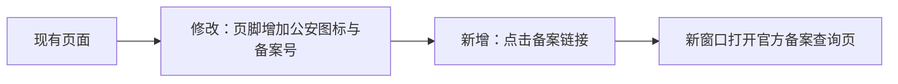

# 公安备案标识更新

日期：2026-11-09（北京时间）。需求和技术方案已在本次聊天获用户确认，范围包含四项目与上线；代码和发布结果等待最终人工验收。

## 已确认需求

- 登录页与各工作台共用 SiteFooter；仅更新正式 Web。
- 保留现有 ICP 信息，增加 `粤公网安备44030002019027号`；图标在左、号码在右，新窗口打开 `https://beian.mps.gov.cn/#/query/webSearch?code=44030002019027`。
- 适配桌面与手机，更新项目记录，验证后独立提交并上线。
- 审核通过状态、号码、地址和图标以用户提供材料为依据；不把收到材料的日期表述为审核通过日期。

## 技术方案

沿用现有页面或共享页脚，不引入数据库、接口或额外运行依赖。新增实体仅为备案图标静态资源：`beian.png` 是用户提供的 36×40 PNG，展示尺寸 18×20，用于备案号左侧标识；图片作为装饰，链接的可访问名称由完整备案号提供。

链接使用 `target="_blank"` 与 `rel="noopener noreferrer"`。图标和文字组成同一链接，窄屏按整个链接换行。前端发布基线为 `411c4954adb982b7ef0f70814cae163b9dd6f9c0`，与实际线上资源对应版本核对后实施；独立工作区保留其他开发分支及未提交改动。

只发布静态文件或在现有运行镜像上替换前端文件；保存旧文件或旧镜像及实际生效配置，逐站验证后继续。后台程序、数据库、模型配置和业务数据保持原版本。失败时恢复本次旧文件或镜像，不采用首次上线时撤销域名的历史回退脚本。

## 验证与发布结果

Vue 类型检查、Vite 构建和 6 项现有前端测试通过；登录和模拟登录后各四种宽度，共 8 组页脚检查通过。

浏览器使用本机 Edge，覆盖 1440、768、390、320 像素宽度，检查唯一页脚、原 ICP 链接、公安链接地址和新窗口行为、原图哈希、18×20 图标尺寸、图标在左、不溢出且不遮挡表单。登录后布局采用本地模拟会话验证，未使用生产账号，也未发起模型生成请求。截图已目视核对。网关布局样例最初遗漏接口字段，补齐模拟响应后检查通过，不计作应用故障。

### 正式发布结果

- 正式地址：<https://helpdesk-rag.linhengyi.xyz/>；源码提交：`ddc72442d09e1392f5f95ee2b01c148b6a2dbda3`。
- 发布目录：`/opt/it-helpdesk-public-security-20261109-ddc7244-r2`。目录内保留发布脚本、资源包、校验清单、备份和结果；备份不在 Web 根目录内。
- 4 个发布资源的线上 SHA-256 与本地发布包逐一一致；公安图标与用户原图字节一致。
- 线上 Edge 浏览器 4 组检查通过：1440、768、390、320 像素宽度，原 ICP 链接、公安备案图标与号码、正确的新窗口及链接、图标尺寸与位置、无页脚横向溢出或表单遮挡。公网截图已目视核对。
- 首页 200；相关健康与未鉴权行为检查通过。生产登录后布局未使用真实账号另测，共用页脚的已登录布局已在本地模拟会话检查。
- 付费模型请求 0 次；最终人工验收待用户确认。

脱敏结果见 [发布证据](public-security-filing-20261109.json)。

前端镜像：`helpdesk-python-web:public-security-ddc7244`，镜像 ID `sha256:5c14e69b19b0a975f9e8f1756ef20328308910db4f4f25fbca1fecbc0324bd1f`。前端来源以 `io.linhengyi.frontend.revision` 标签记录，沿用原镜像的程序及基础环境。其余 8 个运行容器保持原 ID；目标服务的环境变量值、运行身份、启动命令、端口、挂载与资源约束保持一致。

回退镜像为 `helpdesk-python-web:411c495`，仍保留在服务器。`backup-map.json` 对应本轮保存的配置；需要回退时先核对后续变更，只恢复本次目标服务的镜像项，再使用既有完整 Compose 文件集合执行 `up --no-deps --no-build -d --wait web`。随后检查公开页面与健康。

沿用四份 Compose 文件，修改最后一份 `compose.chat-reconnect.yaml` 的 Web 镜像；镜像内及运行后的 Nginx 配置均与原版一致，配置检查通过。正式 `/health` 返回 `status=ok`、`chat_ready=true`。初次发布校验对 Docker 不返回的可选 `Tmpfs` 字段处理不当，自动回退后修正校验器，第二次完整通过。未发布本地会话树或压缩功能。
