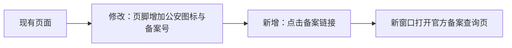

# 公安备案标识更新

日期：2026-11-09（北京时间）。需求和技术方案已在本次聊天获用户确认，范围包含四项目与上线；代码和发布结果等待最终人工验收。

## 已确认需求

- 登录页与各工作台共用 SiteFooter；仅更新正式 Web。
- 保留现有 ICP 信息，增加 `粤公网安备44030002019027号`；图标在左、号码在右，新窗口打开 `https://beian.mps.gov.cn/#/query/webSearch?code=44030002019027`。
- 适配桌面与手机，更新项目记录，验证后独立提交并上线。
- 审核通过状态、号码、地址和图标以用户提供材料为依据；不把收到材料的日期表述为审核通过日期。

## 技术方案

沿用现有页面或共享页脚，不引入数据库、接口或额外运行依赖。新增实体仅为备案图标静态资源：`beian.png` 是用户提供的 36×40 PNG，展示尺寸 18×20，用于备案号左侧标识；图片作为装饰，链接的可访问名称由完整备案号提供。

链接使用 `target="_blank"` 与 `rel="noopener noreferrer"`。图标和文字组成同一链接，窄屏按整个链接换行。前端发布基线为 `411c4954adb982b7ef0f70814cae163b9dd6f9c0`，与实际线上资源对应版本核对后实施；独立工作区保留其他开发分支及未提交改动。

只发布静态文件或在现有运行镜像上替换前端文件；保存旧文件或旧镜像及实际生效配置，逐站验证后继续。后台程序、数据库、模型配置和业务数据保持原版本。失败时恢复本次旧文件或镜像，不采用首次上线时撤销域名的历史回退脚本。

## 验证与发布结果

Vue 类型检查、Vite 构建和 6 项现有前端测试通过；登录和模拟登录后各四种宽度，共 8 组页脚检查通过。

浏览器使用本机 Edge，覆盖 1440、768、390、320 像素宽度，检查唯一页脚、原 ICP 链接、公安链接地址和新窗口行为、原图哈希、18×20 图标尺寸、图标在左、不溢出且不遮挡表单。登录后布局采用本地模拟会话验证，未使用生产账号，也未发起模型生成请求。截图已目视核对。网关布局样例最初遗漏接口字段，补齐模拟响应后检查通过，不计作应用故障。

线上发布结果将在发布完成后补充。
