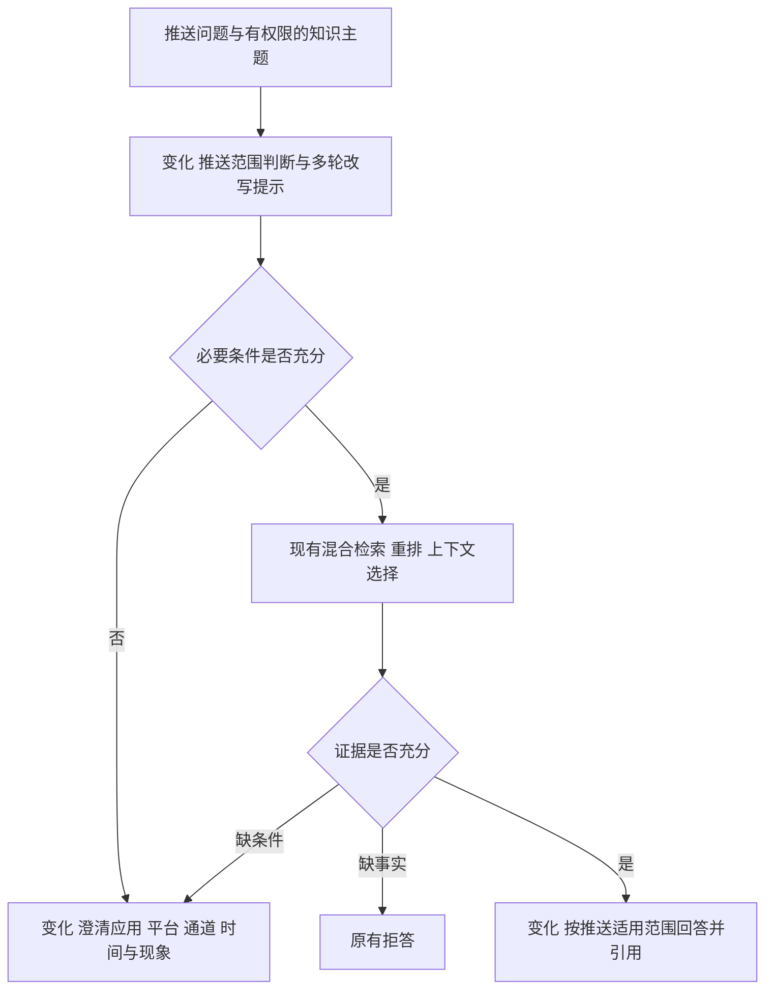

# 推送场景口径统一

用户要求统一所有口径，并沿用本会话已授权的实现、部署、PR 合入及材料同步流程。

## 范围与验收

- 六类在线提示词均使用推送知识助手身份，以应用、平台、厂商/实际通道、版本、时间和观察窗口描述适用条件。去除学校、校园 VPN 和 IT 服务台示例。
- 澄清提示明确补充推送条件，列出当前授权的知识主题；前端空状态、知识库创建提示与之对应。拒答、权限和引用要求保持。
- 检索、重排及评测预算预估使用一致的“适用业务范围”标签。数据库和接口的 `organization` 字段保留兼容，对外含义为适用业务范围，不视为授权证明。
- 简历、面试准备与当前项目说明同步实际行为；保留并标明历史 IT 语料、首次 12 题结果及旧提示词协议，不将其改称新提示词成绩。
- 新增推送协议样本，核对实际模型输入、检索上下文及终态；旧输入/期望文件不覆盖。模型替身只验证协议，不证明真实模型质量。

不新增数据库实体、不重新导入文档、不调整模型身份、推理预算或授权边界。

## 实现与验证

推送协议样本是新的验证资产，例如两种实际通道的说明比较：输入固定元数据、问题和模型替身响应，期望完整请求及结果，用于发现提示或协议漂移。历史样本继续单独验证原参考实现。

澄清原因是图内可选状态字段，例如 `too_many_topics` 表示比较范围超过五个主题，用于提示缩小范围；普通条件缺失仍使用推送应用、平台/通道、时间和现象提示，不新增数据库字段。

材料统一采用“方案对比评测集”“独立验证集”“功能验收样例”。代码中的 `split=dev/test` 是应用方案选择与保留验证的划分，不表示模型训练、微调或权重调参；本轮协议样本属于自动化测试，不是答案质量测评集。

验证包括当前在线资产用词检查、图流程和预算预估回归、推送协议冻结核对、前端测试和构建。发布后单独复核 A12 的新答案及资料范围，首次 12 题统计原样保留。材料使用当前修订号保护、定点修改和读回核对。

## 本地验证结果

- Ruff、mypy 通过，157 项后端测试通过。
- 6 项前端测试、类型检查和生产构建通过；实际 API、Worker 与浏览器联测 25 项通过，页面异常为 0。
- 13 个推送协议案例无漂移，包含范围选择、比较、澄清、拒答、拆分及回退；同时以原参考提交单独复核历史 IT 协议，原输入和期望文件未修改。
- 当前后端源码、提示词及前端模板的用词检查通过，不再包含学校、VPN、企业 IT 身份和旧“适用组织”显示标签。

上述验证使用模型替身，不调用外部模型，也不作为答案正确率。首次并行验证时提示词清单仍有补充说明，出现一次进程内旧缓存与文件新哈希不一致；最终固定全部资产后重新生成推送协议样本并完整执行，157 项全部通过。

## 线上发布与功能回归

运行源码：`411c4954adb982b7ef0f70814cae163b9dd6f9c0`。API/Worker 镜像为 `helpdesk-python:411c495`，Web 为 `helpdesk-python-web:411c495`。后续文档记录提交不改变运行源码。发布包 318 个文件、镜像内 97 个源码/迁移/知识文件均逐一核对；相对原运行版本只允许三个预期后端文件变化，依赖锁定不变。

服务器发布目录 `/opt/it-helpdesk-push-domain-20261024/`，备份在其 `backup/` 下，目录权限 700、文件 600。排空任务并备份后协调切换 API、Worker、Web，操作窗口 57.983 秒。切换前后 19 张表及 29 份上传文件摘要一致，模型配置、预算、环境文件、挂载、数据库容器和卷保持一致。该核验在下面四例真实问答之前完成。

运行容器中的六类提示词哈希与本次清单一致，无旧学校/VPN/企业 IT 身份；公网三个静态文件哈希匹配构建产物。API/Web/数据库 healthy、Worker running，健康接口问答就绪，18 篇推送资料、213 个活动切片不变。接口仍是后台受理和页面轮询，无数据迁移或重新入库。

本轮使用既有模型配置另做四个预先选定的功能回归，均符合预期，引用核对通过：

| 案例 | 问题 | 结果 |
| --- | --- | --- |
| D01 | 我没收到推送，到底什么原因？ | clarify；提示补充应用、平台/通道、时间和现象，并列出“推送故障定位与排查”主题 |
| D02 | 接口成功是否代表用户已看到通知 | completed；区分受理、接收、展示等阶段，缺回执不直接判失败 |
| D03 | Android 13 权限与接受/展示区别 | completed；引用 POST_NOTIFICATIONS 说明及消息生命周期资料 |
| D04 | 校园 VPN 服务器地址 | refused；使用“当前授权的推送资料不足”提示 |

这些是提示词修改后的功能回归，不是独立质量盲测，不与首次 12 题合并计算准确率。首次 A09/A10 的错误和 A12 的旧模板原文保留，不回写旧对话或历史验收结果。常规回退恢复备份中的第四份 Compose 覆盖文件，将三个应用服务恢复到 `894627a`，再检查健康；不整库覆盖后续业务写入。

## 材料中的概念说明

- 检索流程对比：历史 10 题比较完整问题检索 baseline，与保留原问题并增加最多两个子问题的 split-v1，两组均 9/10，后者请求为 47 次、前者 37 次，因此保留 baseline。另 30 题留作独立验证，未运行；没有训练或微调模型。
- 相关性与覆盖：对本题必需库优先选候选，再按整体排名补充，可能挤掉排名更高但来自同一库的片段。受五段、8000 字符预算限制，优先不等于保证；覆盖库也不等于事实充分，缺事实时仍拒答。
- 历史用途：只读当前有权查看的 completed/clarify 历史，最多八条用户/助手消息，用于范围理解及指代改写。生成阶段只接收本轮问题和检索证据，不直接传历史。错误前提仍可能进入改写，引用校验也不证明逐句语义支持，所以不能声称彻底消除历史污染。
