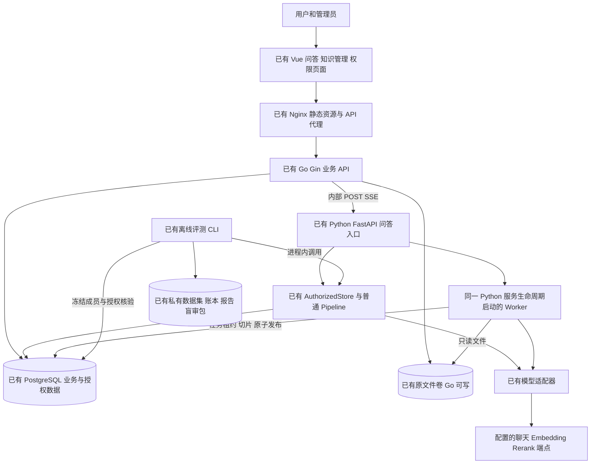
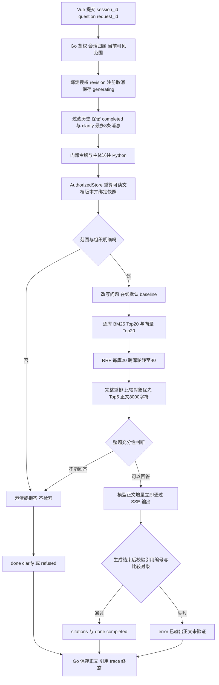
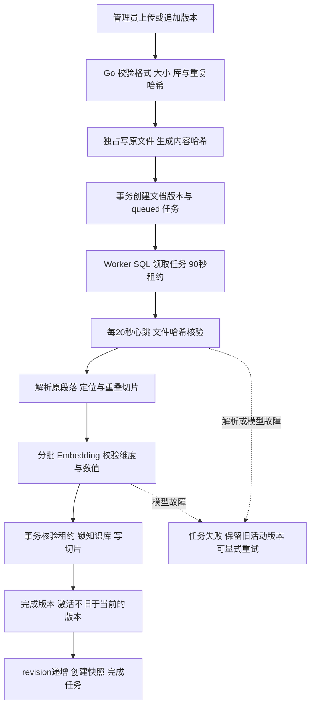
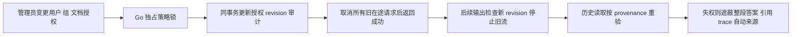
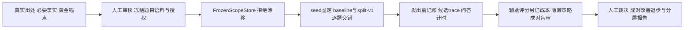

# 当前系统架构与流程

核对日期：2026-10-17。代码快照：`ae16c6c43f0f1b698676d02a15ad0a34bfbec178`。下述是仓库可核对的实现，未将云端正在运行的容器视为已核验。

## 1 当前整体架构

[交互架构图](../../.archify/architecture-current-system-20261017-035056/architecture.html)

Docker Compose 配置为 web、backend、rag、db 四个服务；Worker 与 RAG HTTP 服务同进程启动。web 对主机仅绑定回环地址，Go/Python 在容器网络内；数据库管理端口同样绑定回环地址。公网 HTTPS 与实际云端运行不由该配置自动证明。

Go 目前把路由、业务规则、SQL 和运行生命周期集中在 `main.go/access.go`；Python 把问答步骤集中在 `Pipeline.events`，检索、判断和生成直接交织；Vue 主要状态与页面逻辑集中在 `App.vue`，另有权限页面。SQL 分布在 Go handler 与 Python Store/Worker 中，尚无独立领域 Repository 层。新实现不继承这些代码组织方式。

## 2 当前能力边界

| 领域 | 已实现 | 尚未实现或不能据此声称 |
| --- | --- | --- |
| 身份与会话 | 演示账号引导、管理员/用户、Token、会话归属、请求幂等、单会话生成互斥 | 企业 SSO；多实例统一撤权屏障 |
| 知识管理 | PDF 文本/DOCX/MD/TXT，20 MiB、版本、任务状态、重试、预览、启停、下载 | OCR、PPTX、表格解析、网页抓取 |
| 入库发布 | SQL 租约与心跳、文件哈希、700/120 默认段落切片、Embedding 校验、事务发布与不可变快照 | 独立部署 Worker；分布式任务平台 |
| 范围与权限 | 默认/指定多库、组织路由、歧义澄清、文档组权限、历史遮蔽、在途取消 | 任何模型可扩大知识库范围；撤回已发到浏览器/提供商的内容 |
| 在线问答 | baseline 混合检索、重排、整题充分性、直接流式生成、引用编号与比较对象校验 | 线上 split-v1 开关；逐任务覆盖；条件补查；语义依据检查；缓存草稿 |
| 评测 | 旧 A/B/C/D、冻结 scope、拆解策略、成对交错、盲审、调用账本和续跑校验 | 查询拆解已证明有效；新跨库正式成绩；辅助评委等同人工裁决 |
| 反馈与运营 | 用户来源字段与权限审计 | 旧 v2 规格中的反馈、问题闭环和业务看板尚无对应实现 |

当前 schema 只见普通切片/队列索引，向量检索用 pgvector 距离排序；没有发现 HNSW/IVFFlat 的建索引声明，不能描述为已建 ANN 索引。

## 3 当前问答流程

Go 在每个流片段发送前核对当前 revision，并为业务事件增加 request_id、seq、message_id。用户断开或撤权取消后不应继续发送；无终态断流不能记 completed。当前引用校验发生在增量输出后，无法阻止用户先看到后来校验失败的内容。

旧单库离线入口的融合上限是 20，Rerank 接口只取 Top-5；联合 scope 入口融合最多 40，完整重排后再选 Top-5。跨库最多比较 5 个对象，指定范围最多 32 库。它们是不同实验协议，重实现时不能混成同一个“旧基线”。

`split-v1` 只在独立 scope 评测选择：复合问题最多拆成两个不同的原问题连续片段，每个子查询带完整问题条件；保留原查询，格式非法回退。触发且成功时，不含重试最多增加 1 次拆解和 2 次 Embedding。它不包含动态补查和回答反思。

## 4 当前入库与版本流程

过期 processing 租约可重新领取，最多三次；耗尽则明确失败。权限是文档级，新增版本继承文档当前可见性；新文档默认空用户组，仅管理员可读。原文件和历史版本保留；业务没有永久删除流程。

## 5 当前授权与历史流程

当前采用单 Go 实例进程锁和全局授权 revision，可能连带中止不相关问答。这是明确的单实例一致性设计，不是已经实现的分布式授权协调。Python 在读语料/向量查询时也核验 revision；历史只用于理解指代，不能作为知识证据。

## 6 当前评测与事实记录

旧单库多文档题人工通过 22/30，八题互斥主因为召回 5、选择 2、答案组合 1。旧 30 题候选全覆盖 25/30、最终上下文全覆盖 20/30，二者不等于答案正确率。八题没有发现正文 8000 字符裁剪导致失败的证据。[历史逐题记录](../multi-document-failure-analysis.md)

scope-40-v1 为 10 开发、30 测试，另有 6 条权限夹具；25 题与旧题共享来源段落，4 题为条件辨析。既有开发实验预算仍待确认，不能把工具实现或来源审核当作真实效果验证。[冻结与预算](../scope-40-release-and-budget.md)

## 7 关键数据与证据索引

| 领域数据 | 当前事实来源 |
| --- | --- |
| users、tokens、组、授权 revision、audit_events | [schema.sql](../../db/schema.sql)，[access.go](../../backend/access.go) |
| 知识库、文档、版本、切片、snapshots、ingestion_jobs | [schema.sql](../../db/schema.sql)，[worker.py](../../rag/helpdesk/worker.py) |
| sessions、messages、provenance、strategy_version | [main.go](../../backend/main.go)，[access.go](../../backend/access.go) |
| 部署与文件挂载 | [compose.yaml](../../compose.yaml)，[nginx.conf](../../frontend/nginx.conf) |
| 在线默认策略、充分性与 SSE | [api.py](../../rag/helpdesk/api.py)，[pipeline.py](../../rag/helpdesk/pipeline.py) |
| 组织理解、授权语料、模型适配 | [scope.py](../../rag/helpdesk/scope.py)，[access.py](../../rag/helpdesk/access.py)，[providers.py](../../rag/helpdesk/providers.py) |
| 冻结、成对、账本、盲审 | [scope_runner.py](../../rag/helpdesk/evaluation/scope_runner.py)，[scope_store.py](../../rag/helpdesk/evaluation/scope_store.py)，[scope_report.py](../../rag/helpdesk/evaluation/scope_report.py) |
| 页面和前端事件处理 | [App.vue](../../frontend/src/App.vue)，[api.ts](../../frontend/src/api.ts)，[AccessManagement.vue](../../frontend/src/AccessManagement.vue) |

旧代码在本目录中只承担现状证据作用。新实现以新规格、领域契约与独立验收用例为依据；旧文件路径和函数签名不成为新领域层的必需接口。
