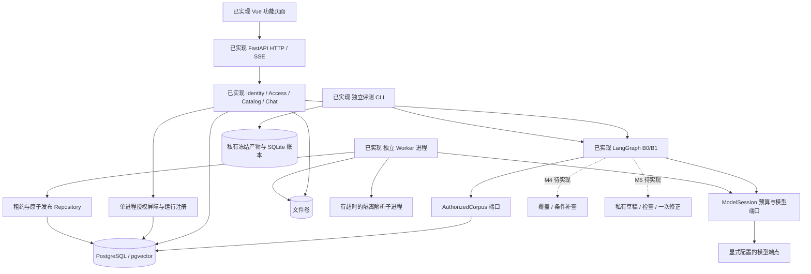
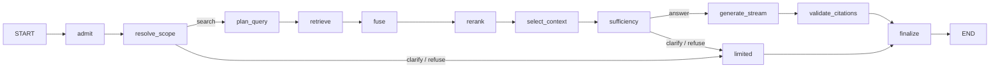

# M2 基线实现与验证

日期：2026-10-17。前置：用户已确认全 Python 方案和 M1。新代码独立放在 `rewrite/`，尚未切换旧入口、Compose 或正式数据。M2 代码/测试交付后需人工验收，不能把本批替身结果当作质量提升。

## 已实现与待实现

| 部分 | 当前状态 | 边界 |
| --- | --- | --- |
| FastAPI 身份、会话、文档与权限 | M1 已验收，M2 接入问答 | 单 API 进程，数据库会话锁阻止第二进程；不具备多副本撤权一致性 |
| 独立 Python Worker | M2 已实现 | SQL 租约、过期重领、最多三次、心跳、隔离解析、批量向量、租约栅栏、事务发布；新版失败保留旧版，旧任务晚完成不覆盖新版 |
| 解析 | M2 已实现 | 文本 PDF、DOCX 段落、UTF-8 TXT/MD；700 字符/120 重叠，坐标属于原段落；无 OCR；解析器是新实现，单独版本化 |
| LangGraph B0/B1 | M2 已实现 | 在线固定 baseline/D；split-v1 仅离线，保留原查询加两个受控片段查询；单库 A/B/C/D 检索变体复用同一图 |
| 模型与预算 | M2 已实现 | 异步 HTTP、结构验证、流结束检查、瞬态最多一次重试、调用前持久账本；流式输出不重放；24 调用与 110 秒；Token 预留为估算 |
| SSE 与权限 | M2 已实现 | 有界队列、逐事件授权与发送屏障、断连取消上游、非法引用与截断报错、终态落盘、API 重启清理问答；不恢复执行中的图 |
| Vue | M2 已实现 | 会话范围/历史、提问/停止、引用定位与授权下载；建库/默认范围/上传/重复确认/版本/进度/切片/启停/重试；用户/改密/停启/组成员/文档授权/审计 |
| 新离线评测入口 | M2 已实现 | 题目/范围/原文/向量哈希/模型/代码/提示冻结，交错执行，持久全实验预算、续跑防重复、盲审包、人工裁决导入；零调用验证默认开启 |
| 旧资产转换与新旧协议逐项核对 | M3 待完成 | 不修改旧私有题集、原始答案或裁决；新规范化题目格式不能直接宣称已兼容旧 CLI 的全部数据维护命令 |
| 查询拆解收益与策略选择 | M3 待完成 | 真实模型费用另行确认，人工裁决后才能锁定方案；新系统不继承旧成绩 |
| 逐任务覆盖、缺失项与证据 ID、一次补查 | M4 待实现 | 目前只有结构 Schema，没有覆盖/候选诊断/补查节点 |
| 草稿依据/完整性检查、一次修正、检查后输出 | M5 待实现 | B0/B1 直接流式，已有引用编号检查不等于语义依据检查；尚无 B3 首字延迟或误改收益数据 |
| 容器切换、生产数据恢复与移除旧代码 | M6 待完成 | 未部署、未推送；未宣称 Linux 容器验收或真实容量 SLA |

最初提出的顺序保持为：先完成 baseline/split-v1 的效果闭环，再分别实现并评估条件补查与回答检查。没有把三种变化同时启用。

## 代码架构与执行流程



当前实际编译图的源码为 [m2-baseline.mmd](diagrams/m2-baseline.mmd)，直接由 `COMPILED.get_graph().draw_mermaid()` 导出。准入事务负责主体、范围、消息幂等和预算上下文；图内 admit 再复核。图的 custom 通道才进入白名单 SSE，updates 只用于服务端读取最终结果。



节点职责、预算与模型、PostgreSQL/文件/HTTP 适配相互分离；没有 import 旧 Pipeline、Store 或 handler。沿用冻结系统 Prompt 是复用实验资产，不是调用旧业务实现。提示哈希见 [manifest](../../rewrite/contracts/prompt-manifest.json)。新请求数据格式、分词/解析细节与旧外部行为仍需 M3 对照，不能由“同一 Prompt”推导出完整保真。

发布事务顺序：有效租约 → 锁知识库/文档 → 校验向量 → 写切片 → 完成版本 → 按 ingest_order 决定活动版本 → 新快照 → 再验租约并完成任务。最后一步失效则整体回滚。解析取消不能立即杀掉线程，隔离子进程有 30 秒硬超时，取消后等待其退出；BM25 的容量只在实际进程计算结束后释放，避免协程取消后队列继续累积。

## 本机运行

使用独立数据库和文件根，显式设置 `HD_` 环境变量；程序不会加载根目录旧 `.env`，也不会加载下面的示例文件。配置字段见 [示例](../../rewrite/.env.example)。

```powershell
uv sync --locked --project rewrite/backend --python 3.12
# 先设置 HD_DATABASE_URL 和 HD_UPLOAD_DIR；以下迁移只允许在确认的隔离数据库执行。
rewrite/backend/.venv/Scripts/python.exe -m helpdesk.entrypoints.migrate --directory rewrite/db/migrations
rewrite/backend/.venv/Scripts/python.exe -m helpdesk.entrypoints.admin admin
rewrite/backend/.venv/Scripts/python.exe -m helpdesk.entrypoints.api
```

另开终端，用相同独立数据库和文件根及显式模型配置运行：

```powershell
rewrite/backend/.venv/Scripts/python.exe -m helpdesk.entrypoints.worker
npm --prefix rewrite/frontend ci
npm --prefix rewrite/frontend run dev
```

模型需显式提供聊天、向量、重排端点和模型名称。支持 OpenAI 兼容的聊天/向量 HTTP、Qwen 原生或 generic 重排协议；没有真实提供商联调结果。远程端点必须 HTTPS，重定向关闭，凭据不进入浏览器、报告或提供商错误回显。API 与 Worker 使用各自连接池与客户端；Worker 入口不启动 HTTP。未配置完整问答模型时 `/chat` 返回 503，不自动回退测试答案。

默认 `48000` 是 UTF-8 字节加最大输出的累计预留估算，会比较保守，可能提前拒绝长输入。缺少匹配 tokenizer 前不宣称 Token 硬上限；M3 必须先确认模型身份、计量和预算可运行性，再冻结实验，不能通过隐藏丢证据绕过预算。

## 新评测入口

输入是 `EvalCase` 的 JSONL：每题明确 id、question、kb_ids、history、expected_behavior、required_facts、forbidden_facts、theme、split、reviewer、reviewed_at、evidence_groups。每组是可替代锚点数组，锚点为 version_id、paragraph、start、end、quote；区间按同一段落合并，重叠切片不重复计分。冻结时校验所有锚点的可见性与原文。reviewer 字段本身不证明审核已发生；真实题目转换和人工确认在 M3 完成。

```powershell
# HD_EVAL_TOKEN 为单独登录的评测主体，不写入冻结清单。
rewrite/backend/.venv/Scripts/python.exe -m helpdesk.entrypoints.evaluate freeze CASES.jsonl --out reports/NEW_EXPERIMENT --max-calls 150 --reservation-limit 1000000
rewrite/backend/.venv/Scripts/python.exe -m helpdesk.entrypoints.evaluate run reports/NEW_EXPERIMENT
# 上一步默认只核对漂移，零模型调用；实际执行另加 --execute，仍需事先获得费用授权。
rewrite/backend/.venv/Scripts/python.exe -m helpdesk.entrypoints.evaluate report reports/NEW_EXPERIMENT --out reports/NEW_REVIEW
rewrite/backend/.venv/Scripts/python.exe -m helpdesk.entrypoints.evaluate adjudicate reports/NEW_REVIEW --decisions DECISIONS.jsonl --out reports/NEW_ADJUDICATION
```

示例预算数字不是付费授权。默认仅 D 变体，逐题交错 baseline/split-v1；单库可显式 `--variants A,B,C,D`：A 为 BM25，B 为向量，C 为 RRF 混合，D 再增加重排。跨库禁止沿用 A/B/C/D 比较作跨库结论。

冻结内容包括题目/语料哈希、授权主体与 revision、版本范围、向量哈希、模型端点身份哈希、代码与提示哈希、seed、实验总预算和执行计划。续跑不覆盖旧结果；曾开始调用却没有结果的运行记 interrupted，不自动付费重放。执行锁残留需核对进程与账本后人工清理。SQLite 请求开始记录在模型 HTTP 之前提交，未知用量保留 null；记录表示已预留的调用尝试，不伪称提供商一定收到或计费。

报告保留错误、中断、pending、候选/融合/重排/上下文证据组覆盖、Recall@5、按阶段用量、正文首字与总时长 P50/P95、分状态样本数。人工裁决前正确率和风险为 null；盲审包不含策略与自评分，映射文件单独私有保存。导入人工 correct、unsupported、omitted_requirements、reviewer、reason 后形成成对结果。陈述级无依据率、覆盖器误判、修正误改率与费用版本在对应后续阶段补充，不从答案级布尔值推导。

## 验证与限制

测试只使用临时 PostgreSQL/pgvector、合成文件和本机模型替身。包括旧库副本升级保留旧字段/向量、真实发布、失租约与乱序完成、失败版本回退、模型协议/缺结束标记/用量未知/重试预算、非法引用、组织范围越界与比较对象缺失、撤权与慢发送屏障、SSE 起始失败、评测冻结/续跑/漂移/人工裁决及浏览器全链路。

本批最终验证：

| 检查 | 结果 | 可复现入口 |
| --- | --- | --- |
| Python 单元/真实 PostgreSQL 集成 | 87 passed | `python -m pytest rewrite/backend/tests -q --tb=short` |
| Ruff / mypy | 通过，63 个源码文件类型检查 | `rewrite/scripts/check.ps1` |
| SSE 解析 | 9 passed | `npm --prefix rewrite/frontend test` |
| Vue TypeScript / Vite | 通过 | `npm --prefix rewrite/frontend run build` |
| 真实浏览器与独立进程 | 14 项通过，page_errors=0；1440 桌面和 390 移动无横向溢出 | `python rewrite/scripts/verify_browser.py` |
| 锁文件 / wheel / sdist | 离线构建通过 | `uv build --project rewrite/backend --out-dir data/rewrite-m2-dist --offline` |
| 无旧源码补齐 | 62 模块全部从 wheel 导入，6 项冻结 Prompt 可读取 | `python -I rewrite/scripts/verify_package.py data/rewrite-m2-dist/helpdesk_backend-0.2.0-py3-none-any.whl` |

上述 Python 均使用 `rewrite/backend/.venv/Scripts/python.exe`。测试前可用 `python rewrite/scripts/test_postgres.py start` 启动独立本机测试实例，结束后用同脚本 `stop`；也可显式配置独立 `HD_TEST_DATABASE_URL`。浏览器脚本需要本机 Edge（或设置 HD_BROWSER），独立启动 API、Worker、Vue 和无费用 HTTP 替身。合成截图/日志位于忽略目录 `data/rewrite-m1-qa/`，不提交业务数据或凭据。测试不依赖 Docker；本机 Docker daemon 不可用，因此没有容器通过声明。

当前不宣称旧真实题逐项保真、真实模型质量提高、生产迁移/备份恢复、负载容量或 Linux 容器已验收。M3 的第一项是核对新旧输入和证据选择差异，再按同模型/语料/评分口径闭环拆解实验；M4/M5 不提前上线。
