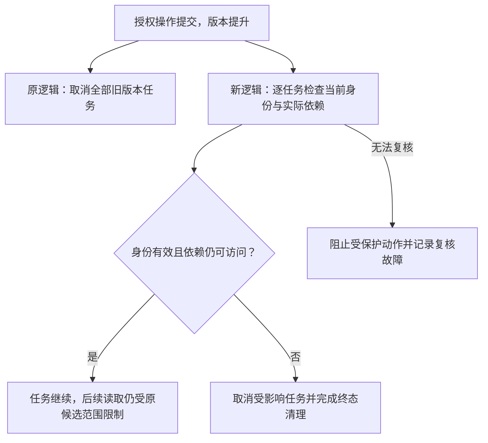

# 按实际影响处理授权变更：需求规格

日期：2026-10-25。

状态：用户已确认需求原则；配套[技术方案](technical-plan.md)已提出，待人工确认。尚未开始实现，也未进行实现验收。

## 1. 问题与目标

当前系统使用全局授权版本号判断运行是否有效。任意授权操作提升版本后，会取消绑定旧版本的在途问答；后续资料检查也会因版本不同而拒绝继续。创建无关用户组、修改其他用户权限等操作可能因此中断无关任务。

已确认的需求原则：

1. 无关授权变更不中断任务。
2. 新增权限不扩大旧任务的资料范围。
3. 只有失去任务所需权限或身份失效的任务才中断。

授权版本变化表示需要重新检查，不能单独作为取消依据。

## 2. 范围与边界

- 目标对象是正在执行的问答及其资料访问、模型调用、进度保存、受理回执和结果公开。
- 任务依赖包括本轮参与处理的资料、知识库元数据，以及实际带入的历史回答来源。只检查最终引用不能满足要求。
- 已完成回答继续按当前权限控制查看；本次需要保存足够的来源信息，避免后续历史绕过撤权。
- 离线评测也需要区分权限变化和实验输入变化；其接入方式属于待确认技术方案，不能直接删掉资料、代码、模型和预算一致性检查。
- 不增加多 API 进程或多副本部署，不改变知识入库任务的租约、发布、重试规则。
- 本次文档不授权部署、真实付费模型调用或重跑既有实验；不修改旧报告、人工裁决和预算账本。
- 新规则需要通过代码更新生效，不能宣称可直接改变已经运行的旧进程行为。

## 3. 概念定义

| 概念 | 定义 | 例子 | 用途 |
| --- | --- | --- | --- |
| 候选范围 | 任务启动时绑定的知识库和文档版本集合，是后续检索上限 | 启动时可检索 A、B 两库的 v1、v2、v3 | 后续新增授权、新版发布不能自动扩大旧任务输入 |
| 实际依赖 | 已进入任务处理并可能影响后续行为的数据来源集合 | 检索读取过 v1；范围判断使用过 A 库组织名；带入过依赖 v2 的历史回答 | 判断任务是否受授权变化影响，并控制结果及后续历史的可见性 |
| 授权复核 | 根据当前可信身份与策略检查依赖是否仍可访问 | 用户退出一个组，但另一个组仍授予 v1 的访问权，复核通过 | 避免仅按发生过的操作或版本号误判失权 |

实际依赖不能由模型自报。服务端依据真实的数据读取和历史选取记录来源。

## 4. 行为要求与验收标准

| 编号 | 要求 | 验收标准 |
| --- | --- | --- |
| A1 | 无关变更不中断 | 创建无关组、创建其他账号、修改其他用户权限后，原任务继续，且只完成一次 |
| A2 | 增权不扩大范围 | 给当前用户新增库或文档权限后，旧任务不读取启动候选范围以外的资料；新任务可按新权限绑定 |
| A3 | 按有效权限判断 | 移除一个组授权但仍由其他组获得同一资料权限时继续；不能仅按退组事件取消 |
| A4 | 失权任务停止 | 已参与处理的资料失去访问权或被停用，任务中断；当前凭证失效或账号停用同样中断 |
| A5 | 未使用资料不误判为实际依赖 | 原候选资料尚未参与处理即被撤权，后续访问排除该资料；只要身份及已形成依赖仍有效，不因此取消 |
| A6 | 覆盖历史与间接影响 | 实际带入的历史回答来源失权时中断；参与关键词排序、重排、范围判断或模型上下文的数据，即使未最终引用，也须覆盖 |
| A7 | 防止并发遗漏 | 资料交给后续处理之前完成依赖登记；授权修改与读取、登记、公开输出交错时，不能漏过失权依赖 |
| A8 | 保持撤权输出边界 | 授权变更成功响应之后，服务端不再发出受影响任务的失权内容；已发出的内容无法追回 |
| A9 | 准入和终态一致 | 在途任务不因无关全局版本变化被取消，也不因同一原因让受理回执或结果轮询误报失败；失权后不得落为成功终态 |
| A10 | 保留来源与审计 | 启动授权版本保留作为审计信息；实际依赖可供结果查看、后续历史与撤权复核使用；不伪造原始版本和快照 |
| A11 | 保留原有停止规则 | 用户主动停止、超时、服务关闭等规则继续生效；重复撤权不得再次打断终态清理 |
| A12 | 不把复核故障当作授权有效 | 数据库等故障导致无法确认权限时，暂停受保护动作或以明确故障结束；不能放行旧缓存，也不能将所有任务记为实际撤权 |

## 5. 流程变化

变化位置是授权提交后的在途处理及运行中的权限检查，不是降低资料访问、输出与历史查看的权限要求。

## 6. 依赖粒度与兼容性

- 当前关键词检索会读取所选库的全部切片参与排名计算。这些已读取资料均属于依赖，不能用最终 Top-5 引用代替。
- 知识库名称、组织等元数据进入范围判断后，同样受到当前可见性约束。失去某篇文档权限但仍能合法查看该库元数据，不自动等同于元数据失权。
- 历史只继承本轮真正选入的消息来源，来源需要向后传递，不能只保护直接上一轮。
- 旧消息只能使用已有来源记录保守复核，不虚构过去没有记录的精确读取范围；兼容边界需在交付时说明。

## 7. 验证与交付要求

使用本地模型替身和真实测试数据库验证正反例及并发交错，测试不得访问付费模型。至少覆盖 A1–A12、跨用户任务隔离、历史依赖传递、空资料范围和终态竞争。

交付时提供变更摘要、测试结果、兼容及部署边界，并为独立且已验证的代码改动提交对应 commit。技术方案确认之前不开始业务代码实现；实现完成仍需人工验收。
