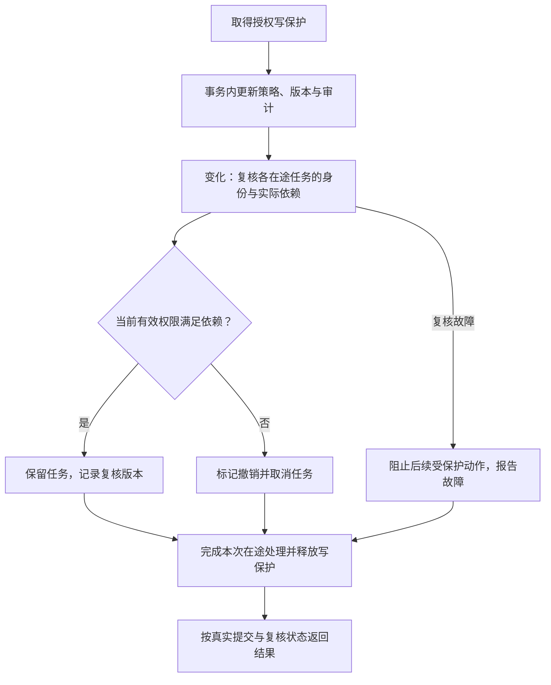

# 按实际影响处理授权变更：技术方案

日期：2026-10-25。状态：待人工确认，尚未实现。

依据：[需求规格](spec.md)。用户已确认需求原则；本文件细化候选范围与实际依赖的处理、历史来源和验证方式，不表示实现已获确认。

## 1. 实现思路

保留全局授权版本用于审计与触发复核，取消“版本不同即任务无效”的运行判断。服务端固定每个任务的候选范围，另行累积实际依赖；授权操作提交后检查在途任务的当前有效权限，只取消复核发现失权的任务。

首版遍历当前进程的在途任务，不引入消息队列、分布式索引或新的任务执行框架。

## 2. 新增及调整实体

| 实体 | 定义与拟包含信息 | 例子 | 用途 |
| --- | --- | --- | --- |
| 运行授权上下文 | 仅由服务端持有的运行记录，包含任务标识、可信用户及凭证标识、启动授权版本、冻结候选范围、实际依赖和撤销状态 | 任务 R1、用户 U1、凭证哈希、启动版本 28、候选 v1/v2、已依赖 v1 | 绑定任务身份、实施复核和取消；明文凭证不落入审计、公开响应或模型输入 |
| 依赖记录 | 服务端累积的资料版本标识、已使用的知识库元数据标识、带入的历史消息及其来源 | v1 已参与关键词排序；A 库组织名已用于范围判断；历史 M1 的来源 v2 已继承 | 覆盖直接与间接影响，支持并发登记和结果来源保存 |
| 已选历史输入 | 本轮最终选取的历史消息内容及对应来源，而非只返回角色和文字 | 最近实际带入的四轮消息及其依赖并集 | 让执行授权检查与真正带入模型的历史保持一致 |

冻结候选范围沿用现有范围绑定能力；拟拆分“原始输入身份”和“最近复核版本”，不能通过修改启动版本或重算原始快照掩盖变化。具体类型名在编码时按现有模块命名约定确定。

## 3. 在线问答流程

### 3.1 准入与历史

1. 在准入读保护内校验当前凭证，绑定候选知识库与文档版本。
2. 按当前权限筛选历史，应用现有历史条数限制后，只继承最终带入消息的来源。
3. 建立运行授权上下文，登记任务与初始历史依赖。准备完成到注册执行之间仍须重新复核，避免漏掉这段时间内的撤权。
4. 保留请求幂等、同会话互斥、应用持有后台任务和浏览器断开后继续执行的现有行为。

### 3.2 新的数据读取与依赖登记

1. 读取前校验当前可信身份和已形成依赖。
2. 只在启动候选范围内查询当前仍可见、启用的资料；尚未使用即被撤权的候选资料不进入后续处理。
3. 把实际读取的数据来源登记为依赖，完成后才将数据交给后续步骤。读取与登记使用同一段读保护，授权写入不能插入两者之间。
4. 范围判断实际使用或发送给模型的库名称、组织信息也登记为依赖。不能仅根据最初绑定的全库列表继续使用失权元数据。
5. 当前关键词检索读取全库切片，其来源全部计入依赖；重排及最终上下文不能清掉之前已经形成的依赖。

依赖只累积，不因后续引用减少而删除。权限扩大时也不能重新绑定更大的候选范围。

### 3.3 授权修改与选择性取消

复核依据当前组并集及文档可见性，不按“发生退组”“改过文档授权”等事件直接推断失权。已经处于取消清理阶段的任务不重复取消。

写保护内的复核调用不能再次取得同一把读保护，避免自身等待。若事务已提交后复核失败，明确区分“授权已提交”和“后续复核故障”，不能假装事务回滚；未确认权限的运行不得继续发布内容。

### 3.4 模型准入、落盘与公开响应

- 模型发送准入、进度保存、成功终态保存前继续检查身份与实际依赖；网络等待、模型生成和长计算不占用授权保护。
- 受保护动作的准入和授权写入之间保留短临界区，明确其先后关系；不能仅凭很早之前的一次检查放行后续动作。
- 回执及问答结果轮询采用与其实际响应数据匹配的复核规则，避免全局版本变化造成后台继续但前台误报失败。
- 普通资料响应仍须防止“计算响应后、发送前撤权”的竞态；此次不得简单删除现有 HTTP 响应保护。
- 答案来源保存实际依赖及继承历史来源，供当前查看与后续提问复核。版本停用判断对管理员与普通用户也需明确，不依赖管理员可见性短路绕过运行安全要求。
- 复核故障阻止受保护动作，保留真实错误原因；撤权取消不覆盖已经完成的合法终态，成功终态也不能覆盖已生效的撤销。

## 4. 离线评测接入

评测进程独立于 API，不能宣称进程内注册表能同步取消它。采用显式的当前身份与冻结输入授权复核，在调度等待、调用准入及结果发布等检查点发现失权后停止。

评测依赖以冻结实验实际输入为依据。用于比较策略的冻结语料不得因撤权而静默缩减后继续计算，否则两组输入不再一致；这与在线任务尚未读取的候选资料处理不同。

将全局授权版本审计与实验输入身份校验分开：版本改变但冻结输入仍授权且实验身份一致时可继续；冻结语料、活动版本、代码、提示、模型、预算和调度状态等现有一致性检查仍保留。

新协议需要明确标识检查语义；不改写旧 manifest、报告和预算账本以绕过兼容检查。旧实验目录能否续跑必须服从现有代码及协议身份校验，不因本次授权规则调整自动获得续跑资格。已运行的旧评测进程需要按新版本启动才能使用新规则。

## 5. 拟涉及模块

| 模块 | 修改目的 |
| --- | --- |
| `application/barrier.py`、授权用例及身份变更入口 | 用当前权限复核替代批量取消；覆盖创建账号、组变更、文档启停、改密、停用和主动注销等相关入口 |
| `application/chat.py`、`ports/chat.py`、`ports/corpus.py` | 绑定运行上下文，携带已选历史来源；协调依赖登记和各检查点 |
| `adapters/postgres/corpus.py` | 将候选范围限制、当前授权检查和真实读取来源分开；不再因无关版本变化拒绝旧运行 |
| `adapters/postgres/chat.py`、`conversations.py` 及会话用例 | 保存和继承来源，兼容旧消息；避免范围过宽或丢失历史来源 |
| `graph/baseline.py` 等实际图入口 | 登记真实使用的元数据、检索及模型输入来源 |
| `adapters/http/app.py` | 保留发送前保护，调整问答回执与轮询的版本误判 |
| `entrypoints/evaluate.py` 及相关冻结、导出逻辑 | 区分授权复核与实验输入身份；保留旧协议兼容边界 |
| 对应测试及设计文档 | 更新全局取消的旧断言，补齐隔离、失权和并发验收；清理已失效逻辑 |

优先复用现有消息来源 JSON 保存依赖；若实现核查发现需要数据库结构变更，应先说明新增字段及迁移兼容性，不静默扩大本方案。

## 6. 验证计划

| 类别 | 必须覆盖 |
| --- | --- |
| 无关与增权 | 无关用户、账号和组操作不取消；新增权限不扩大旧任务；其他用户任务隔离 |
| 实际失权 | 使用过的文档撤权、停用；改密、停用账号、注销及凭证到期；组并集仍授权时继续 |
| 动态依赖 | 候选但尚未参与处理的资料撤权后被排除；关键词全量读取、范围元数据及非最终引用来源仍受保护 |
| 历史 | 只继承实际选入历史；跨多轮来源传递；来源撤权后停止；旧消息保守复核 |
| 并发 | 读取与登记交错、准备与注册交错、模型准入、进度与成功终态保存、响应发送前撤权；无死锁，连续撤权不打断清理 |
| 故障与恢复 | 复核数据库失败不放行、不冒充实际撤权；空范围；用户停止、超时和重启恢复原行为 |
| 评测 | 无关授权版本变化可通过复核；冻结输入失权或内容漂移停止；预算和旧目录身份约束继续生效 |

先用本地模型替身及真实 PostgreSQL/pgvector 执行对应集成测试，再运行后端测试、Ruff 和 mypy；若涉及前端或公开协议则补充对应构建、协议或浏览器验证。所有验证禁止真实付费模型调用。

文档阶段仅检查链接、规格与方案对应关系、差异格式和工作区范围，不能把这些检查写成实现测试通过。

## 7. 确认与交付节点

1. 当前节点：需求原则已确认，规格与本技术方案已落盘，方案待人工确认。
2. 方案确认后：在独立分支实现、验证并提交对应代码 commit，报告已知限制。
3. 人工验收确认后：标记交付完成；部署或真实实验另按明确授权执行。
