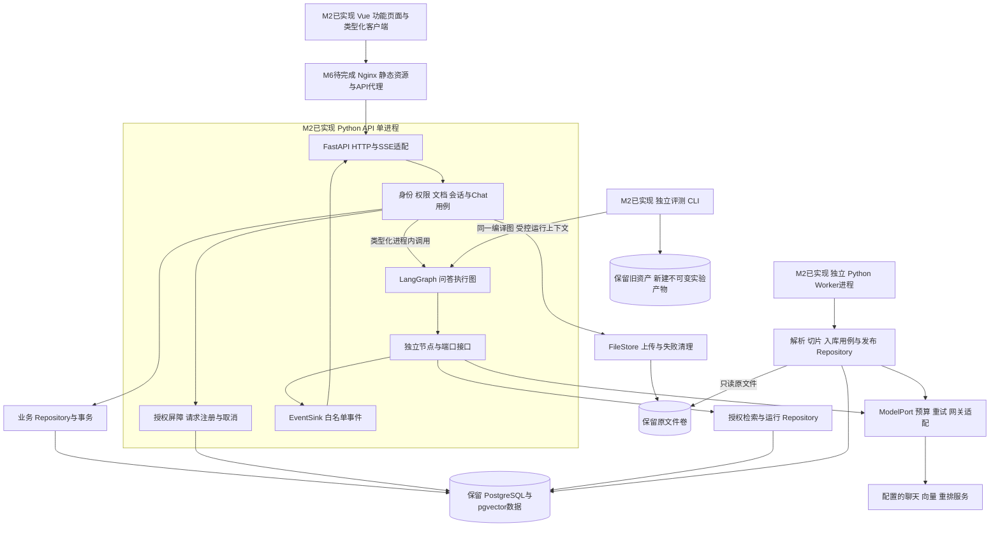
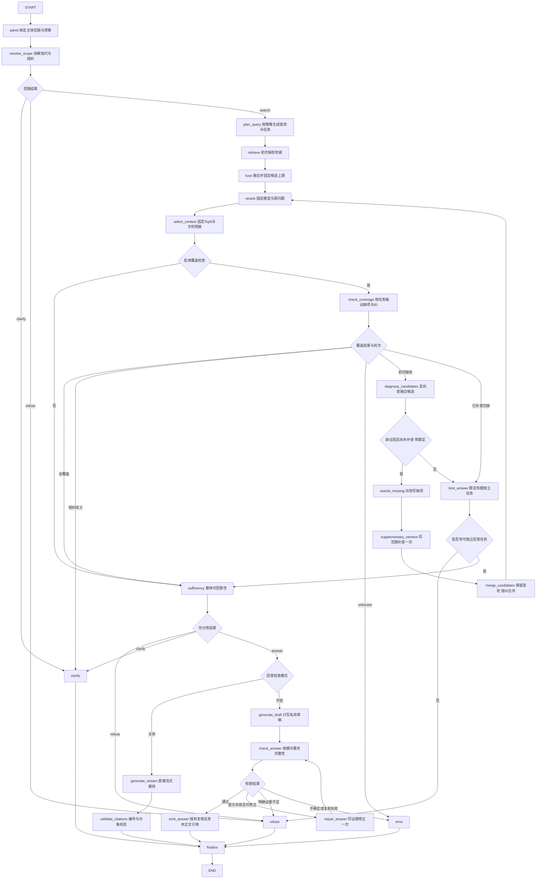

# 全栈重实现技术方案

日期：2026-10-17。状态：已由用户确认；M1 已人工验收；M2 基线已实现，等待本批代码/测试验收。对应 [需求规格](spec.md) 和 [领域与接口契约](contracts.md)。用户已确认改为全 Python 后端。本方案取代双语言目标架构及旧方案中“普通 Python 自行编排”的选择，M1 的具体实现与验证见 [实施记录](m1-implementation.md)，M2 当前实现与限制见 [M2 记录](m2-implementation.md)；完整目标及新策略质量尚未验证。

## 1 从零选型与职责

| 选择 | 对应需求与收益 | 接受的代价和边界 |
| --- | --- | --- |
| Python/FastAPI 业务 API | 身份、文档、权限、会话、事务与 SSE 由领域用例实现；业务与问答同进程调用，减少双语言契约和转发成本 | 需要类型检查、运行时输入校验和测试；阻塞或 CPU 密集工作不得直接占用异步事件循环 |
| Python/LangGraph 问答编排 | StateGraph 明确表达覆盖、补查和回答修正的条件边，减少维护自制执行器 | 需要理解图状态更新与流协议，增加框架集成和版本验证；不能替代业务权限、成本和语义校验 |
| 独立 Python Worker | 文件解析、切片、Embedding 与事务发布在独立进程运行，隔离入库负载和恢复周期 | API/Worker 分别管理连接池与生命周期；同一代码包不意味着同一运行进程 |
| Vue 3/TypeScript | 问答、知识管理、权限界面与有类型的流事件状态 | 按功能拆页面/组合式状态/客户端，前端不判断可信权限 |
| PostgreSQL/pgvector + 文件卷 | 业务授权、不可变知识版本、任务租约、检索与审计能在单机事务边界管理 | 文本检索和向量规模先实测；不宣称搜索集群或高并发 SLA |
| 单机 Compose | 进程边界清晰，支持本地与 Linux 一致构建 | 首版单 API 进程授权屏障；Uvicorn workers=1，不能直接增加 API worker 或副本 |

全 Python 的取舍：本项目已需要 Python 的解析、检索、评测与 LangGraph 生态，当前没有必须复用的 Go 平台或压测证明的业务 API 瓶颈。增加 Go 会带来内部协议、跨服务取消、终态协调、双构建与数据职责维护成本，现阶段没有足够收益抵消这些成本。统一后端可复用类型和数据库适配，不以“Python 一定更快”作论据。代价是失去独立 Go 业务运行时的依赖隔离与编译期约束，并需要更严格的异步执行纪律；用清晰模块、类型检查、独立 Worker 和负载验证控制风险。Vue 仍采用 TypeScript，“全 Python”仅指后端。

选择 LangGraph 的收益是本项目已有明确的条件分支与反馈循环，执行图本身会持续演进。自有代码虽然可以完成，但要长期维护阶段转移、状态更新和循环约束；从零设计时，统一编排的收益足以支持引入轻量库。框架适配和依赖维护是已知代价；没有测量数据，不以“更快”或“更省资源”作为选择依据。

首版只用 StateGraph、类型化状态、条件边、Runtime Context 和 custom 流；不启用在线 checkpoint、LangSmith 外传或运行中人工暂停。服务重启后按失败/中断结束请求，历史与任务仍由业务存储保证。未来若启用执行恢复，需另行设计授权重绑定、版本快照、重复模型调用和幂等，不能直接沿用过期权限。

Worker 使用 PostgreSQL 租约而非 LangGraph checkpoint 承担持久任务恢复；问答编排与入库租约各有单一真值，避免双重调度。Worker 与 HTTP 服务改成独立进程入口，可共用同一 Python 镜像，但各自拥有连接池、信号处理、健康检查和资源限制。在线图通过异步模型/数据库适配执行；同步文件 I/O 由有界线程池承接，CPU 密集解析在 Worker 执行，本地检索计算若实测阻塞事件循环则通过有界进程执行器隔离，不能仅加 async 就当作非阻塞。

目标 Compose 为 web、api、worker、db 四个服务：web 提供 Vue 与同源代理，api 是唯一业务 HTTP 入口，worker 没有公开端口。评测与迁移是按需执行的独立 CLI。API 与 Worker 可使用同一镜像的不同入口，原 rag 服务与 Go 镜像在 M6 切换后退出运行。默认依赖与离线评分依赖分组锁定，生产 API 不安装非必需评测工具；后续若模型依赖故障或实测资源争用需要更强隔离，再拆 Python 问答服务，不预先恢复内部 HTTP 链路。

技术依据：[FastAPI 异步执行](https://fastapi.tiangolo.com/async/)、[服务进程](https://fastapi.tiangolo.com/deployment/server-workers/)、[Graph API](https://docs.langchain.com/oss/python/langgraph/graph-api)、[持久化](https://docs.langchain.com/oss/python/langgraph/persistence)、[custom streaming](https://docs.langchain.com/oss/python/langgraph/streaming)。依赖在首次实现时解析、锁定并验证与评测依赖兼容；不无条件跟随最新版。

## 2 目标架构与全栈分层



新实现最终目录建议：

```text
backend/pyproject.toml                单一 Python 包与锁定依赖
backend/src/helpdesk/domain/          身份 范围 文档 会话 问答与终态规则
backend/src/helpdesk/application/     Identity Access Catalog Chat 入库与评测用例
backend/src/helpdesk/graph/           图装配 状态 路由 独立节点
backend/src/helpdesk/ports/           Repository FileStore ModelPort Budget EventSink
backend/src/helpdesk/adapters/http/   FastAPI 路由 中间件 SSE与旧字段投影
backend/src/helpdesk/adapters/postgres/ psycopg 查询 事务与映射
backend/src/helpdesk/adapters/        模型网关 解析器 文件与报告
backend/src/helpdesk/entrypoints/     API Worker Eval Migration 独立入口
backend/tests/                       领域 契约 图路径 PostgreSQL与进程联测
frontend/src/features/               auth chat knowledge access
frontend/src/shared/                 类型化客户端 SSE解析 公共组件
contracts/                           HTTP SSE 领域 schema 和冻结提示资产
db/migrations/                       有版本号的 SQL 与副本验证
```

这是最终目标路径，M1/M2 已在独立 `rewrite/` 根目录中实现并验证基础模块，进度以 M2 记录为准；禁止 import 根目录旧源码；完成全栈和数据验收后整体替换最终入口并移除旧实现。旧代码保留在 Git，不长期维护两个生产写入者。

架构图中的 LangGraph、ModelPort 和 Repository 表示可复用代码职责。离线评测在自身进程装配同一图定义与受控依赖，不调用线上图实例，也不共享在线连接池或请求预算。

每个业务节点接收类型化输入并依赖新端口，禁止调用旧 `Pipeline.events/retrieve`、旧 Store 或通过 subprocess 启动旧服务来完成实际业务。旧实现只允许在独立、只读测试环境作外部行为对照。

## 3 数据访问与基础用例

Python 领域层统一定义 Principal、Document、Conversation、Evidence 等规则；Application 组织用例与事务；HTTP 适配仅解析协议和映射结果。所有 SQL 放新 Repository，禁止 handler 拼装业务 SQL。问答和 Worker 通过 AuthorizedCorpus、Snapshot、JobLease、Publication、RunLedger 等端口读写；图节点不直接查数据库。业务模块不依赖 FastAPI 请求对象，LangGraph 不包含账号管理等非问答用例。

发布事务由 Python Publication Repository 独占负责：检查有效租约并锁知识库/文档 → 写入切片向量 → 完成版本 → 仅在顺序允许时更新 active_version → 根据当前启用文档创建新快照 → 完成任务。同事务任一步失败全部回滚；上传、权限、启停不能绕过该规则修改活动版本。

统一采用 psycopg 的显式 SQL，不额外引入 ORM。授权查询、向量距离排序和发布锁定在 SQL 中明确表达，契约用真实 PostgreSQL/pgvector 负例验证。首版沿用精确向量距离排序和当前 BM25/RRF 口径，不同时引入 ANN、全文索引替换或新切片策略。

原文件通过 FileStore 保存 storage_key 和内容哈希，领域层不依赖 Windows/Linux 绝对路径。旧 path 字段先保留并在副本迁移中映射到卷内键，核对每文件哈希，不能猜路径后删文件。API 对原文件卷可写，控制上传与失败清理；独立 Worker 的原文件卷只读挂载。

新增 RunLedger/ModelAttempt 记录调用开始、完成、未知用量和停止原因；公开 messages 仅由 Python Chat 用例写终态。私有草稿全文默认只在内存；离线对照需要保存时进入受控私有评测产物，线上诊断优先保存 hash/ID/分类，不默认永久保存模型输入全文。

## 4 LangGraph 节点与路由

[完整目标执行流程 SVG](diagrams/target-workflow.svg) · [Mermaid 源码](diagrams/target-workflow.mmd)

下图是完整目标：M2 已实现 B0/B1 基线路径，覆盖/补查分支待 M4，草稿/检查/修正分支待 M5。当前实际编译图见 [M2](diagrams/m2-baseline.mmd)。每个框对应职责明确的节点，分支由代码校验后的枚举和预算决定；不能一个 prompt 返回整条流程的“自检成功”。完整流程采用 Mermaid/SVG 交付，保留所有条件与回边；交互布局的未通过尝试不计为已验证图表。



### 4.1 状态与依赖

GraphState 包含 query_plan、绑定 scope、候选排名、选中证据映射、coverage、draft、answer_check、次数、终态和 trace 摘要。Runtime Context 提供本请求模型客户端、授权检查器、Repository、Budget 和 EventSink。图对象可以复用，所有请求数据与模型用量必须隔离。

路由模型输出只能选当前授权元数据中的 ID。图的边名和节点名不由 LLM 自由生成。采用顺序节点保持首轮实验可比性；若未来并行子查询，必须先定义有序合并和预算原子预留，再单独验证性能与结果变化。

### 4.2 任务与覆盖

B0 不新增任务提取或覆盖调用；B1 仅执行受控拆解，保留原查询与两个带完整条件的连续片段查询。B2 复用有效拆解片段建立任务；没有可复用片段时，任务提取最多一次，不为 baseline 偷偷增加首轮子查询。最大两个任务不等于每任务只能有一个必要事实。

覆盖器首先只看模型实际将收到的最终上下文。缺失时可对最多 40 个融合候选做一次定向诊断；诊断预算不足、输入过长、格式错误或语义未知必须标 uncertain。selection_loss 不启动无意义的补查，也不隐式替换原证据选择算法。

补查后重新走原重排与 Top-5 选择，再查覆盖。stable chunk_id/version_id 与原文区间用于内部映射，最终 C1…C5 在最后一次选择后重建。补查没有净改善也原样记录，不能追加第二轮搜索。

部分回答时 `limit_answer` 先限定可独立成立的已支持子集，充分性与生成只针对该子集，系统 Prompt 不变；固定说明模板列出未完成要求。该输入范围变化是 B2 明确行为，报告中单列，不算整题通过。

### 4.3 回答检查

草稿生成、依据检查、修正、复核、公开输出是独立阶段。首次生成保持冻结的系统提示与模型；检查/修正提示独立版本化。关键陈述需映射实际引用及原文支持位置；不能因出现合法编号就通过。

首次检查不通过且剩余预算允许才修正；修正次数由代码增加，模型不能重置。复核仍失败不再生成或裁剪一个新答案来绕过次数上限。明确无证据走拒答，检查故障/不确定走 error；检查器自身的误判需人工统计。

## 5 SSE、取消和授权

Python 只通过 custom 事件输出明确的业务事件，不把 `values/updates/debug` 或完整状态透传给浏览器。框架的“私有状态”不是安全过滤器；HTTP 输出采用字段白名单，私有草稿、候选与判断理由不得进入公开 trace。

B3 先立即发送 status，再在内存生成草稿与检查；只有最终通过的正文走 answer_delta，然后发送 citations 和 done。B0/B1/B2 仍能运行直接流式模式作为可比对照；线上采用哪个模式由效果、误改和体验验收决定，不因框架接入自动全部开启。

Python Chat 用例按原契约保存同一 request_id 的唯一消息，SSE 适配保证 seq 有序、至多一个网络终态，处理客户端断连和图异常。没有完整终态的流记 error/interrupted，不当成完成；断连后的数据库落盘使用有界独立上下文，不能继续模型业务。

授权在 Python Chat 准入、读元数据/原文/向量、模型调用前和每次公开输出前核验。首版仅部署一个 API 进程（Uvicorn workers=1、一个副本），持有支持取消的异步读写屏障与在途请求注册表；不能把原 Go 进程锁直接当作多进程能力。

准入在读屏障内验证 revision 并注册请求；每次公开事件在读屏障内复核授权并进行有界写出。Access 更新取得写屏障，在同一数据库事务更新策略、revision 和审计，提交后标记并取消旧请求，再返回成功。写屏障等待已进入的事件写出结束或有界失败，避免校验后到发送前的竞态；不得在屏障内等待模型或长时间读取文件。权限写入只经 API Access 用例；Worker 不写授权。撤权成功响应后服务端不再发出旧权限片段，但之前写入网络缓冲区或已发送到提供商/浏览器的内容无法追回。后台诊断与离线评测也必须绑定并复核各自授权，不因同包运行绕过。

断连、撤权和总 deadline 取消请求任务，并关闭上游 HTTP 流；异步取消不能强行终止已经执行的同步函数，隔离任务返回后也不得落盘或输出过期结果。多 API 进程/副本需先设计跨进程撤权协调和一致性验收，不能直接加 --workers 或 replicas。

provenance 包含已咨询的范围和元数据依赖，不仅是最终引用。Chat 用例初始保存保守范围依赖，不能仅以最终 citations 缩小到忽略已咨询组织信息；读取历史时对失权派生信息整体遮蔽。缓存键包含有效版本集合和授权 revision，不能只按问题或公开快照复用受限证据。

首次进度、草稿首字、公开正文首字、总时长分别记录。B3 的 server_ttft 以公开正文为准，拒答/澄清无正文首字则记 null，并另记完成耗时。服务端、浏览器和离线评分各自计时，不混成一个 P95。

## 6 请求预算与故障策略

| 项目 | 首版开发配置与执行规则 |
| --- | --- |
| 任务/查询 | 独立任务 ≤2；B1 首轮原查询加最多2子查询；补查最多1轮2查询 |
| 检查次数 | 最终上下文覆盖 ≤2；融合候选诊断 ≤1；回答检查 ≤2；修正 ≤1 |
| HTTP | 每问答模型请求 ≤24，含重试和三类模型；离线评委单列且受全实验上限约束 |
| Token | 累计输入+最大输出预留 ≤48000；覆盖三类模型和重试；可靠计量前不宣称硬保证 |
| 输出 | 提取/改写 ≤512；覆盖/候选诊断/回答检查 ≤1536；草稿/修正 ≤2048 |
| 上下文 | scope 融合候选 ≤40；最终≤5段/8000正文字符；候选诊断输入≤12000 Token |
| deadline | 开发建议110秒，包含排队、SQL、模型、退避和输出；Python API外层清理窗口120秒；单模型≤25秒且不超过剩余时长 |
| 图步数 | 建议 recursion_limit=48，作为程序缺陷防线；补查/修正仍由业务次数单独控制 |

24 次是硬请求槽而非平均用量，不能承诺每个阶段都能执行。发请求前先预留槽和 Token，再发 HTTP；成功后对账，超时缺用量保留未知和预留。模型没有匹配 tokenizer/可靠上界时，只能报告估算，不得批准声称 Token 硬限制的运行配置。

瞬态错误的重试与退避也在预算里；流式生成一旦输出不自动重放。可选补查、修正启动前必须留出生成/检查/终态余量；没预算时安全结束，不能把错误当知识缺失。异常分类区分权限变化、取消、超时、限流、模型结构非法、数据库失败、无证据和语义未通过。

## 7 重实现与实验分开验收

### 7.1 验证顺序

先冻结旧协议与 Prompt 资产，并在只读旧提交上准备外部输入/输出契约。新实现完全根据本目录实现，用替身和冻结条件验证模型输入、调用数量、检索证据、SSE 事件与终态。时间和新增 graph metadata 允许变化；任何其他差异须列为明确设计变更。

在进入新的策略收益测试前，完成已有 scope-40 开发集 baseline/split-v1 真实成对实验并人工裁决，决定保留哪个检索方案。可在旧提交只读评测环境先闭环；新实现随后按同协议验证，不能直接把旧实现成绩赋给新系统。费用和实际模型/价格需单独确认。

| 组 | 唯一变化 | 说明 |
| --- | --- | --- |
| B0 | 新系统当前检索基线 | 与旧外部协议保真，但标注新代码与图版本 |
| B1 | B0 增加 split-v1 | 不改模型、语料、重排、证据预算和生成提示 |
| C0 | 锁定方案加只观察的覆盖检查 | 不改变答案；测覆盖器误判与成本，不冒充正常请求延迟 |
| B2 | 锁定方案加条件补查 | 必要的覆盖、诊断、缺项改写是机制组成；生成 Prompt 固定 |
| B3 | 锁定检索方案加回答检查与有限修正 | 首次生成 Prompt 固定；缓存模式和检查/修正提示明确版本化 |

如果要区分覆盖器更保守与补查的贡献，开发集加“同一覆盖器但禁止补查”的预登记对照。B3 先固定相同证据和初始草稿测修正，再独立做正常请求端到端延迟；缓存实验不能声称线上时延。

### 7.2 指标

分别报告候选并集/融合/重排/最终上下文必要证据组覆盖与整题全覆盖、固定 K 的 Recall@5、人工正确率、错误整题拒答和子任务遗漏。无依据陈述同时给出陈述级与答案级比例。误改率为“原人工正确草稿最终变错 / 人工正确初始草稿”，零分母 null。

报告覆盖器假通过/假缺失、检查器错误放行/错误阻断、修正成功/失败、额外调用、重试、各阶段 Token、未知用量和费用版本。问答和辅助评委分账；公开首字与总时长 P50/P95 按终态分层，列样本量、超时与取消，不只留成功快样本。

错误、超时、中断保留在质量分母，pending 单列。人工盲审隐藏策略和检查器自评分，依据事先冻结的必要事实与原文裁决；模型不能既修改又独自宣布有效。旧失败题只回归，B2/B3 收益用新独立冻结题；scope-40 的旧来源重叠与条件辨析局限继续披露。

## 8 分阶段实现与发布

| 阶段 | 全栈产出 | 验收与停止条件 |
| --- | --- | --- |
| M0 已确认 | 现状架构、流程、需求、目标图与契约 | 人工确认后进入新代码；此阶段不改依赖或业务库 |
| M1 已人工验收 | 新 contracts、迁移、Python domain/application/repository、身份/权限/文档/会话、图端口及新Vue骨架 | 空库初始化、旧库副本升级、API权限负例、无旧源码依赖 |
| M2 基线已实现待验收 | 新 Worker、解析/切片/发布、新 LangGraph B0/B1、新模型适配、评测、完整 Vue | 全部已有功能回归；API/图/独立Worker联测、浏览器、取消、撤权、版本发布与恢复 |
| M3 实验闭环 | 旧拆解结果裁决与新协议核对、锁定检索方案 | 无改善保留负结果；未付费授权不运行；新系统不继承旧分数 |
| M4 覆盖与补查 | 新图 A1/A2、C0/B2、覆盖误判与独立题 | 单次补查、同权限同快照、选择损失不绕过；人工质量/开销验收 |
| M5 回答检查 | 新图 A3、B3、草稿隔离、误改与首字测量 | 修正≤1、复核≤1、草稿零泄露；先锁定容忍阈值再正式测 |
| M6 统一切换 | 新Python API/Worker/Vue/DAL完整构建、恢复演练、升级/回滚说明、移除旧实现 | 人工代码/测试验收；生产数据迁移、推送与部署单独执行 |

开发与联测在独立数据库、文件根和端口运行，不让新旧 Worker 同时写同一套正式任务。新实现可以读取受控副本，不能用启动应用的方式隐式迁移业务库。最终新服务和旧服务不同时作为生产写入者。

迁移前记录表数量、主键、关键内容哈希、活动版本、权限、快照和文件哈希。先备份并在独立实例恢复，再验证新 Repository 读取与新任务发布。旧向量身份/维度不匹配时显式停止，不静默重嵌入。回滚以备份与兼容 schema 为依据，不执行粗暴 DROP 或覆盖历史报告。

## 9 验证证据与面试说明

新测试由领域不变量和外部协议生成，不能仅把旧测试复制后改 import。Python 覆盖业务用例与事务、权限屏障、SSE准入及实际图路径、模型输入、预算、取消、并发请求隔离、未知输出和故障；Vue 覆盖流事件、部分回答、取消、断连、权限与知识管理。集成测试使用真实 PostgreSQL/pgvector 和本机模型替身，禁止访问付费模型。

至少检查：未授权 ID 与元数据、同库不同文档权限、撤组/停用账号、历史泄露、缓存隔离、草稿阶段撤权、补查前撤权、非法引用、比较对象缺失、三项任务被静默丢弃、候选有据却未选中、补查仍缺、原正确被改错、超过调用/Token/deadline、Worker失租约与乱序完成、数据库短暂失败、API/Worker重启、独立备份恢复。

新 Python 类型检查、pytest、Vue 类型/构建、全栈联测和浏览器检查通过后按阶段 commit。真实质量报告另列，模型替身只证明控制逻辑。面试描述依据实际实现和数据：可以说明统一 Python 如何减少跨服务协议与部署成本、单进程和依赖隔离的限制，以及采用 LangGraph 的结构收益、框架适配代价与基线对照；尚未开启的节点和未完成的效果实验都明确标注。

本次文档与图表核验结果在 [交付验证记录](validation.md) 中列出。目标图是设计，现状图才绑定已有代码快照，不能混用来源。
