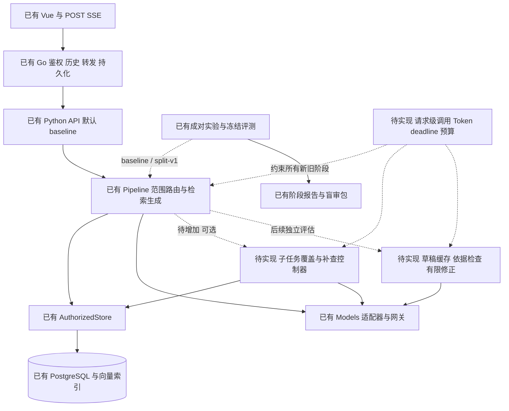
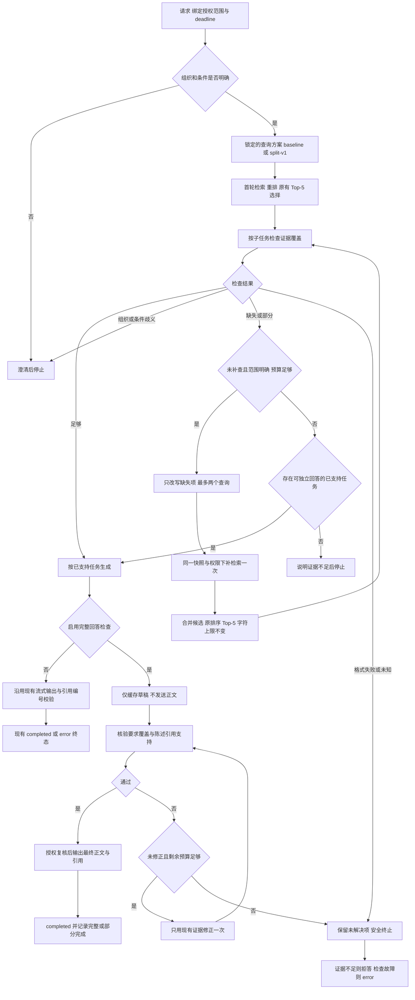

# 查询拆解效果验证与自适应检索技术方案

日期：2026-10-17。状态：待人工确认的技术方案。

后续决定：用户已明确采用 LangGraph，后续确认后端改为全 Python，Vue 与数据访问层仍全部重新实现。执行依据转为 [全栈重新设计](redesign/README.md) 中待确认的规格与技术方案；本文保留最初效果问题与实验设计背景，其中“普通 Python 自行编排”和保留 Go 服务的目标选择均已被替代；本文其余代码引用与既有能力仍为旧系统记录。

先完成已有 baseline / split-v1 成对实验，判断查询拆解是否改善必要证据召回，再决定是否实现条件补检索。回答检查作为后续独立实验。本次交付仅包含方案与图表，不代表新增机制已经实现，也不启动付费实验。

本方案承接 [效果深度需求](spec-effect-depth.md)、[实施记录](effect-depth-implementation.md) 和 [冻结与预算记录](scope-40-release-and-budget.md)。已有能力按代码快照 `68a1ab654e2b42d77af876def3ae9fcb43aa2aab` 核对；下文所有“建议配置”和新接口均为待实现设计。

## 1 需求与实验边界

旧多文档结果为人工通过 22/30；八道失败的互斥主因是候选召回不足 5、重排选择损失 2、答案组合遗漏 1。重排损失连同次因涉及 4 题，不能与主因直接相加。详见 [逐题分析](multi-document-failure-analysis.md)。

| 规格编号 | 需求 | 验收依据 |
| --- | --- | --- |
| R1 | 先检验已有拆解效果，逐次只增加一个机制 | 冻结配置、成对输出、阶段覆盖与人工裁决 |
| R2 | 复合问题逐子任务检查必要证据 | 每项有状态、缺失事实、证据 ID 与原文支持位置，不能只给总分 |
| R3 | 只对缺失项补检索一次 | 补查次数 ≤1、查询数 ≤2，范围与权限不扩大 |
| R4 | 独立验证回答的完整性和依据 | 关键陈述映射引用；最多修正一次，修正后复核 |
| R5 | 明确停止，限制调用、Token 与耗时 | 正常完成、部分回答、澄清、拒答、未验证错误分别记录 |
| R6 | 将收益与副作用同时纳入评测 | 召回、人工正确率、错误拒答、无依据陈述、改错比例、调用、Token、P95 |

企业操作步骤、账号配置、地址和组织政策必须得到本次授权知识库证据支持。模型常识、聊天历史和评估模型的自信不能替代证据。组织或学校不明确且会改变答案时，先澄清，不用补检索猜测组织。

首轮不调整切片、Embedding、RRF、重排模型、去重策略、证据分配或生成提示。子任务证据分配与正文去重若要实施，另开实验；现有跨库比较对象保留不等于已实现逐子任务覆盖。

## 2 已有部分与待实现部分

| 模块 | 已有部分 | 待实现部分 |
| --- | --- | --- |
| Web 问答 | Vue → Go → Python；POST SSE、状态、正文增量、引用和终态 | 回答检查模式下缓存草稿、检查后输出；前后端新增终止原因展示 |
| 范围与权限 | 组织路由、歧义澄清；AuthorizedStore 在取正文和向量检索前过滤；Go 输出前核验授权 revision | 将相同约束贯穿补查、检查、修正、缓存与输出；阶段切换时主动检查撤权 |
| 检索 | BM25 + 向量 → RRF → 重排；跨库候选轮转至 40，最终 Top-5、8000 正文字符；比较对象优先保留 | 固定同一范围的条件补查与候选合并，沿用原排序和上下文规则 |
| 查询拆解 | 离线 scope 实验 `split-v1`，保留原查询，最多两个子查询；校验为原问题不同连续片段，失败回退 | 真实效果闭环；若验证通过，再增加受控线上策略配置 |
| 充分性判断 | 整体 `answer/refuse/clarify`，返回证据编号；比较对象缺失时拒答 | 按子任务给出 covered/partial/missing/ambiguous/unknown，区分缺召回与选择损失 |
| 引用校验 | 引用编号存在性校验；跨库比较要求引用全部指定对象；发生在正文增量已发出之后 | 陈述语义支持、用户要求遗漏、修正后的复核；完整检查模式下阻止草稿泄露 |
| 可观测性 | `retrieval-trace-v1` 候选/融合/重排/上下文、分阶段耗时、重复文本观测、上下文哈希 | 每轮覆盖映射、停止原因、修正记录、请求级预算、公开输出时刻 |
| 评测 | 冻结 ScopeCase、普通用户权限、成对交错执行、续跑账本、盲审包、改善/退步汇总 | B2/B3 策略入口、语义支持裁决字段、误改率、覆盖检查误判和新延迟指标 |
| 预算 | 模型适配器计 HTTP 请求并记录用量；离线实验共享请求上限；单请求超时与输出上限 | 线上每次问答的总调用上限、累计 Token 预留、总 deadline 和可选阶段保底预算 |

已有 `split-v1` 只由独立 scope 评测选择，Python 在线 API 仍构造默认 baseline。代码拒绝在旧单库离线入口启用拆解；不能把“联合入口中只选了一个库”和“旧单库离线入口”混为一谈。

当前仓库报告目录未发现新的 scope 成对实验结果；既有预算文档仍记为待确认。40 题已冻结为 `scope-40-v1`，10 开发、30 测试，另有 6 条权限协议。25 题与旧题共享来源段落，4 条是条件辨析，并非确认的真实矛盾；该集合不能称为全部事实独立的新盲测。

## 3 架构

[交互架构图 查看已有问答与实验架构](../.archify/architecture-adaptive-retrieval-20261017-090000/architecture.html)

实线为已有在线链路，虚线为已有离线实验链路。交互图附代码来源。入库、文件下载等外围能力不在本次架构切片中。



控制逻辑继续放在 Python RAG 服务，Go 继续负责用户权限、会话与 SSE 持久化。采用显式有限状态流程和普通 Python 模块即可，不引入新的 Agent 框架、向量库或服务。新增覆盖、检查模块依赖现有 Store/Models，不能独立访问更广泛的知识库。

建议新增 `rag/helpdesk/coverage.py`、`adaptive.py`、`answer_check.py`、`budget.py`；在现有 pipeline、providers、scope runner/report 上增加接入。上述路径当前不存在。先实现离线实验路径，效果成立并验收后再接入在线策略；策略由服务端白名单控制，不能让客户端绕过预算或自行选择更宽权限。

## 4 先完成已有查询拆解实验

| 步骤 | 使用已有能力 | 产出与决策 |
| --- | --- | --- |
| 1 配置锁定 | 冻结题目/语料/授权清单、manifest、模型路由、价格版本 | 核对实验环境、实际模型版本和向量兼容性；漂移则停止 |
| 2 开发集成对运行 | `scope-experiment`，10 题，seed=12，两策略交错 | 保留所有结果、失败、用量和未执行题；不追加重跑挑答案 |
| 3 阶段诊断 | 候选、融合、重排、最终上下文覆盖 | 判断拆解是否改善首要瓶颈，以及收益是否在重排后消失 |
| 4 人工盲审 | 随机左右顺序、冻结标准、原文与必要事实 | 逐题改善、退步、均通过、均失败，决定保留 baseline 或 split-v1 |
| 5 锁定后测试 | 30 题正式划分，仅比较预先锁定方案 | 人工裁决后报告该轮结果，披露来源重叠和小样本限制 |

两组固定模型、语料、权限、Top-5、8000 正文字符、融合上限 40、温度、生成和充分性提示。现有拆解在触发时最多额外增加 1 次拆解 LLM 和 2 次查询 Embedding，即无重试最多增加 3 次 HTTP 请求。

既有开发提案为两组共享 150 次模型 HTTP 请求，含重试和辅助评分。它仍需单独预算确认，本方案不视为运行授权；历史人民币估算不作为当前价格或金额硬上限。启动前重新核对路由与价格。本轮仅设计，不执行模型调用。

若拆解提高候选覆盖但最终上下文没有改善，应报告证据选择瓶颈；不得通过同时改 Top-K 或去重来包装该轮拆解收益。若无净收益，保留负结果和 baseline，后续补查可基于 baseline 独立评估。

## 5 自适应检索流程

[交互流程图 查看待实现的有界控制流程](../.archify/workflow-adaptive-retrieval-20261017-090000/workflow.html)

该流程是分阶段开启后的目标行为。B0/B1 不包含新覆盖判断或补查；B2 才启用检索适应，B3 才开启完整回答检查。



权限改变、用户取消和总超时在所有阶段均可终止，不等待下一次模型返回。补查不能进入第二轮补查；修正不能触发新检索，也不能再改第二次。某轮超时或结构化结果非法时不重复调用“直到满意”。

## 6 子任务与证据覆盖契约

### 6.1 任务来源

只根据用户问题和已消解的指代建立任务，不读取评测标准答案或黄金证据组。B2 单独的任务提取调用最多一次，最多两个任务，任务必须保留组织、时间、操作对象、比较要求。它与缺项查询改写分开记账。即使锁定 baseline，也不能为了构造任务偷偷启用 split-v1 的额外检索。

锁定 split-v1 时优先复用已经验证的两个连续片段；无可用拆解时才使用上述提取调用。单任务沿用原问题作为一个任务。无法可靠表达两项以上的任务时先澄清或保留既有流程并标记 `adaptive_skipped`，不得静默丢掉其余用户要求。提取器与覆盖器的错误都纳入人工抽查。

### 6.2 覆盖结果

以下是待实现的结构化格式示例，ID 为示意值，缺失证据用空数组表示，不编造对应 ID。

```json
{
  "schema": "coverage-v1",
  "round": 0,
  "context_hash": "example-context-hash",
  "tasks": [
    {
      "task_id": "T1",
      "requirement": "完成问题中第一项操作",
      "status": "covered",
      "support": [{"chunk_id": "chunk-example-1", "start": 12, "end": 35}],
      "missing_requirements": [],
      "reason": "必要步骤在所引正文中完整出现"
    },
    {
      "task_id": "T2",
      "requirement": "完成问题中第二项操作",
      "status": "partial",
      "support": [{"chunk_id": "chunk-example-2", "start": 0, "end": 18}],
      "missing_requirements": ["用户要求的前置步骤未得到支持"],
      "reason": "仅有后续操作，没有前置条件"
    }
  ],
  "missing_task_ids": ["T2"],
  "behavior": "supplement"
}
```

`covered` 必须支持该任务全部要求；`partial` 表示只有部分要求有据；`missing` 表示无支持；`ambiguous` 表示条件会改变结论；`unknown` 表示检查失败或无法判断，不能当成已覆盖。程序校验 task_id 集合、状态、ID 所属快照、字符区间以及必要字段；原文引用位置只能证明模型确实引用了该文本，语义支持仍可能误判。

覆盖器首先只看实际最终上下文，避免将“候选有证据”误记成“回答已收到证据”。若缺失，再在本轮已授权融合候选中做一次定向诊断，输入仍限 40 段，并受单独 Token 上限约束。结果区分：

| 状态 | 含义 | 动作 |
| --- | --- | --- |
| `not_in_fused_candidates` | 融合候选中也未找到支持，不能证明原始候选并集完全没有 | 允许一次针对缺项的补检索 |
| `selection_loss` | 融合候选有支持，但未进入最终上下文 | 本轮保留原选择策略，记录并安全部分回答或拒答；证据分配另开实验 |
| `uncertain` | 候选过长、诊断失败或无法确认支持 | 不声称“没召回”；停止自动补查，记录待复核 |

候选诊断是待实现 B2 的一部分，最多一次，不构成第二套隐藏重排。离线黄金锚点可进一步把候选、融合、重排和预算损失拆开；线上不能使用这份黄金答案。

### 6.3 身份与引用

覆盖与补查内部使用稳定 chunk_id、version_id、locator 与正文哈希。`C1…C5` 只在最终上下文冻结后分配；补查合并后必须重新建立映射并重新检查覆盖，禁止沿用旧编号。

补检索只对诊断为 `not_in_fused_candidates` 的缺失任务改写，每任务最多一个查询、总数最多两个。固定附带完整问题条件与绑定组织；输出不接受新的库 ID、组织 ID 或文档版本。查询扩展可用同义表述，不能引入新的操作事实。新增查询经现有 BM25/向量检索，保留首轮候选，按 chunk_id 合并，再使用原 RRF、库轮转、统一重排与原上下文选择。候选总上限仍为 40；原文去重和任务名额分配不在本轮实现。

补查后有证据仍被原选择丢掉时照实记为 selection_loss，不为获得正收益临时保留指定段落。补查失败则只使用首轮已经验证的支持，不能宣称补查成功。

## 7 回答依据检查与 SSE 取舍

### 7.1 独立的回答检查

B3 在已锁定检索方案上开启。首次生成复用同一生成提示与模型，只改变输出缓冲方式；检查提示、修正提示各自版本化，不能同时重写正常生成提示。

待实现 `answer-check-v1` 输出 `claims[{claim_id, span, task_ids, citations, support_status, evidence_spans}]`、`missing_task_ids`、`unsupported_claim_ids`、`invalid_citation_labels` 与 `verdict`。核验企业操作步骤、组织、年份、前提和顺序；“缺失某步骤”仅当用户要求或必要条件包含它时判遗漏，不从模型常识发明额外标准。

关键陈述必须有实际引用支持；只检出合法编号不能算通过。已支持任务不得漏答；未支持任务应明确说明资料不足。比较题必须按对应组织引用，不能拿另一个组织的证据支持结论。

检查不通过时，最多调用一次修正模型，输入仅含原问题、同一最终证据、草稿和问题清单。修正后再检查一次；仍不通过就不输出该草稿。若明确为证据不足，则输出安全拒答；检查器超时、格式错误或语义不确定则输出 `error`，不能把系统故障伪装成正确拒答。可以独立回答的子任务，在生成前便限定范围；不再增加第三轮“裁剪后检查”。

### 7.2 输出模式

| 模式 | 正文何时可见 | 优点与代价 | 实验用途 |
| --- | --- | --- | --- |
| 当前直接流式 | 模型首个正文增量即发送；引用编号在结束后检查 | 首字较早；错误内容可能已经显示 | B0/B1/B2 保持该行为 |
| 缓存后输出 | 草稿只在服务端，检查通过才发送最终 `answer_delta` | 可以阻止未通过草稿泄露；首字增加草稿生成与检查耗时 | B3 目标行为 |

保持 POST SSE，连接后立即发送已有 `status`，检查期间增加 `checking` 等进度文本。首个进度事件不算答案首字。最终正文可按段发送已有 `answer_delta`，随后发送最终 `citations` 和 `done`；缓存后的发送只是传输分段，不能宣传为模型实时逐 Token 输出。不新增“先显示再撤回草稿”协议。

复用现有 `completed/refused/clarify/error/interrupted`，在 trace 增加 `completion_kind=full|partial`、`unresolved_task_ids`、`check_status`、`stop_reason`。部分回答只有在限定范围内检查通过时才标 completed，并明确用户哪些要求仍无资料支持。Go 仍只持久化发给用户的最终正文；草稿、检查理由和内部候选不得作为正文或公共 trace 暴露。

为此需新增私有诊断记录与公开 trace 的字段投影：在线终态只允许输出耗时、预算汇总、完成范围和停止原因；覆盖细节、候选诊断、草稿与修正版本存入受权限控制的私有评测或诊断记录，并按保留策略清理。当前链路会传递 pipeline trace，不能直接把新增内部结构放入现有 `done.trace` 后交给前端。

至少记录 `first_status_ms`、`draft_ttft_ms`、`public_answer_ttft_ms`、`total_ms` 和浏览器首字/总耗时；B3 的 `server_ttft_ms` 以公开正文为准，避免把草稿首字伪装成用户首字。拒答和澄清没有正文首字时记 null，另记响应完成耗时。浏览器与服务端指标分别比较；评分耗时排除在问答延迟之外。

## 8 总预算与明确停止

以下是 B2/B3 开发期建议值，尚非上线 SLA。先用真实开发实验校准，再人工锁定。

| 约束 | 建议值或规则 |
| --- | --- |
| 子任务与补查 | 最多 2 项；补查最多 1 轮、2 个查询 |
| 覆盖与候选诊断 | 最终上下文覆盖最多 2 次；首轮候选诊断最多 1 次 |
| 回答检查与修正 | 检查最多 2 次；修正最多 1 次；草稿最多 1 份 |
| HTTP 请求 | 每问答最多 24 次，包含 LLM、Embedding、Rerank 和重试；离线评委另账且受实验共享上限约束 |
| 累计 Token | 每问答最多预留 48000 输入与输出 Token，包含所有模型类型和重试；未知用量保留未知并停止可选阶段 |
| 输出 Token | 任务提取/查询改写各 ≤512，覆盖/候选诊断/回答检查各 ≤1536，草稿与修正各 ≤2048 |
| 输入边界 | 最终上下文 Top-5、正文 8000 字符不变；候选诊断输入 ≤12000 Token，超限记 uncertain，不偷偷截断后当作完整候选 |
| 总 deadline | 建议 110 秒，包含排队、检索、模型、重试与输出，预留至既有 Go 120 秒取消边界的余量 |
| 单次模型 deadline | 不超过 25 秒且不超过剩余总时长；可选阶段启动前预留生成、检查与终态发送时间 |

24 次上限的无重试核算：范围路由/改写保守预留 2，拆解 1，首检 Embedding 最多 3，首检重排 1，既有充分性 1，生成 1，共 9；B2 最多任务提取 1、覆盖 2、候选诊断 1、改写 1、补查 Embedding 2、重排 1，共额外 8；B3 最多检查 2、修正 1，共额外 3，总计 20，余下 4 个请求槽用于受限重试。该分配是上界预留，不是平均开销，也不承诺总时限内能执行所有阶段。

B2 保留现有充分性调用，不把替换充分性模型混入补查收益。完整回答仍检查原问题；部分回答先由程序限定为可独立回答的已支持子任务，充分性与生成均只处理该子集，沿用原系统提示和同一最终证据。响应末尾由固定模板列出未完成要求，不能让生成模型自行补齐。该用户输入范围变化属于 B2 的明确行为，须单列“部分回答”，不能计作整题正确。覆盖与充分性不一致时记录 disagreement，执行更保守的行为；要删除重复判断，应作为后续独立成本实验。B2 的覆盖/诊断本身会影响拒答，因此评测另设“只观察覆盖”的诊断运行，不改行为，用来区分检查与实际补查贡献。

新增请求级 Budget 管理器必须覆盖原有范围路由、原检索与生成调用，不能只限制新增节点。每次发出前预扣调用槽、估计输入与最大输出；用量回来后对账。Token 硬边界依赖与实际模型匹配的 tokenizer 或可验证保守上界：尚未支持可靠计量的模型不得启用“已保证总 Token 上限”的模式。Embedding/Rerank 输入也须计量；不能用现有 8000 字符冒充 Token 硬限制。请求超时无用量时保留预留，不记零。

重试复用现有瞬态错误规则，但同时受请求槽和总 deadline 约束；退避不能越过 deadline。预算临近耗尽时跳过补查或修正，仍按已经验证的证据安全结束。授权变化时立即取消模型请求、清理草稿且停止输出，不沿用旧授权重试。网络、数据库、模型格式故障保留 error，不归入“知识库无答案”。

## 9 评测设计

### 9.1 策略矩阵

| 阶段 | 策略 | 相对对照唯一新增项 | 使用的数据 |
| --- | --- | --- | --- |
| B0 已实现 | baseline | 当前 scope D | 既有 10 开发与锁定后的 30 测试 |
| B1 已实现工具 待真实验证 | split-v1 | 受控拆解与必要的多查询合并 | 同题同配置与 B0 成对 |
| C0 待实现 诊断 | 锁定的 B0 或 B1 + 仅观测覆盖 | 不改变答案，测覆盖器错误与潜在触发 | 开发集，输出与检查成本另记 |
| B2 待实现 | 锁定检索方案 + 条件补查 | 覆盖驱动的一次补检索机制，生成提示固定 | 新开发案例调试后锁定；独立新题验证 |
| B3 待实现 | 锁定 B2 或此前最优方案 + 回答检查 | 草稿缓冲、依据检查与最多一次修正 | 固定同一检索结果，并做独立端到端对比 |

B2 若需区分“更保守判断”和“补查本身”的影响，在开发集增加同一覆盖器但禁用补查的对照。生成与评分口径保持一致，额外实验提前登记，不在正式集看结果后挑选对照。

B3 先缓存并冻结成对相同的检索证据和初始草稿，比较“原草稿”与“检查后的结果”，直接计算误改；再进行正常请求的端到端运行，测真实首字和总延迟。缓存实验不计为完整在线延迟。两组都保留原始草稿和最终答案，不能仅按两个独立生成结果的差异宣称是修正带来的效果。

### 9.2 指标与分母

| 指标 | 口径 |
| --- | --- |
| 候选与上下文覆盖 | 候选并集、融合、重排、最终上下文分别统计必要证据组覆盖与整题全覆盖；Recall@5 单列 |
| 人工答案正确率 | 人工通过数 / 预期可回答题数；失败/超时/中断保留，未执行题单列 |
| 错误拒答 | 可回答题被整题拒答数 / 可回答题数；部分缺答单列 |
| 无依据陈述 | 人工判无支持的关键陈述 / 全部关键陈述；另报含无依据陈述的答案占比 |
| 原正确被改错 | 相同初始草稿经人工判正确、最终被判错误数 / 人工正确的初始草稿数；零分母记 null |
| 覆盖器误判 | 宣称 covered 但人工判不足；宣称缺失但人工判够；各报计数、分母和原因 |
| 检查器副作用 | 正确答案被拒绝、错误答案被放过、修正成功/失败、检查异常，分别报告 |
| 开销 | 问答与离线评分各自的 HTTP 请求、重试、输入/输出 Token、未知用量和价格版本 |
| 延迟 | 公开首字、完成时延 P50/P95，按 completed/refused/clarify/error 分层；同时列超时/取消率和样本数 |

权限 6 条回归仍须全部通过，新增补查后撤权、缓存草稿时撤权、修正前撤权用工程夹具验证，不能代替真实效果题。任何未授权正文或元数据到达模型或用户均不得发布。

旧八题只作定向回归，旧 30 题阶段结果不当新收益依据。完成 B1 后，已查看结果的正式题也转为后续回归资产；B2/B3 的新收益需新的独立冻结题集，按事实主题与来源段落核对隔离。优先补充未覆盖的新真实素材，不能只改写旧题后称独立。组织歧义、无答案、部分可答、正常对照和真实冲突的覆盖缺口须单列。

保持模型实际版本、语料快照、权限、提示版本、seed、预算、超时和评分口径一致；网关别名相同不代表底层模型未变。版本漂移停止跨组比较。运行清单还需加入覆盖/检查/修正提示哈希、SSE 模式、各上限和 tokenizer 版本。现有成对比较会校验相同 commit，因此新旧策略必须同时保留在同一实验提交中，不直接拿旧 commit 的报告充当新实验对照。

离线评价模型不参与实际答案修正；即使用不同评委或不同提示，也只能算辅助评分。开发小样本全部人工复核，正式小规模实验建议全部人工盲审，至少覆盖所有改善、退步、拒答、无依据和误改样本，并随机抽查“均正确”与“均错误”。判据来自事先冻结的原文与必要事实；盲审包不暴露策略或检查器自评分。

### 9.3 采用与停止标准

B1 采用前需看到候选必要证据覆盖改善，并核对最终答案净改善、错误拒答和额外开销；如主要收益未传到上下文或答案，保留诊断结论。B2/B3 的采用要求人工净改善为正，且错误拒答、无依据陈述和改错比例不超过事先确认的容忍阈值；质量绝对目标仍参考既有正确率 ≥85%、Recall@5 ≥82%，不把小样本达标视为普遍保证。

延迟、成本和误改的可接受阈值须根据开发集数据，在正式测试前人工锁定，不能跑完后再改标准。未锁定这些阈值时可以报告实验结果，但不能宣称已满足上线条件。小样本报告逐题计数和不确定性，不宣称统计显著或线上成功率。

## 10 实施顺序与人工确认

| 阶段 | 交付 | 人工确认节点 |
| --- | --- | --- |
| P0 当前方案 | 已有/待实现清单、规格 R1–R6、架构、流程、实验与预算设计 | 确认需求理解及技术方案；确认后再启动新增代码 |
| P1 现有实验闭环 | 预算核对、B0/B1 开发成对结果、盲审与采用建议 | 单独确认付费预算；开发结果人工裁决；锁定正式策略 |
| P2 条件补查 | 先做 C0，验证覆盖器，再实现 B2；测试、独立新题与报告 | 代码和测试验收；题目/标准审核；正式结果裁决 |
| P3 回答检查 | B3 缓存草稿、语义支持检查、有限修正、误改与延迟报告 | 单独确认检查模式取舍；代码/测试及结果验收 |
| P4 在线采用 | 受控策略开关、监控、回滚与兼容验证 | 满足预定阈值后确认是否上线；部署另行执行 |

代码验证至少覆盖：缺一个子任务只查该项；候选有据但选择丢失；补查仍缺只部分回答或拒答；歧义先澄清；补查不扩范围；旧 C 编号失效；非法覆盖/检查格式；达到请求与 Token 上限；限流重试受 deadline 约束；草稿不进入 SSE/历史；修正一次后仍失败；在途撤权与用户取消。使用模型替身和隔离数据库验证控制逻辑，真实质量用人工评测验证。

修改 Python 后执行相关 pytest 与权限联测；涉及 Go SSE/终态则执行 Go test/vet 与跨服务联测；涉及 Vue 则验证类型构建、真实 SSE 事件与取消/断连。每阶段验证后独立 commit，按节点交付人工确认；推送与部署不由本方案自动授权。回滚切换到已验收策略，读取新 trace 的字段保持可选，历史数据不重写。

## 11 代码证据索引

| 事实 | 代码入口 |
| --- | --- |
| 现有拆解校验与降级 | [pipeline.py](../rag/helpdesk/pipeline.py)，`subqueries`，66–88 行 |
| 多查询、40 候选、跨库对象选择、Top-5 | [pipeline.py](../rag/helpdesk/pipeline.py)，`retrieve_multi/context`，41–64、130–177 行 |
| 整体充分性、先输出再校验引用 | [pipeline.py](../rag/helpdesk/pipeline.py)，`events/valid_citations`，23–29、237–273 行 |
| 在线默认 baseline 与每请求模型对象 | [api.py](../rag/helpdesk/api.py)，`chat/stream`，49–77 行 |
| 授权过滤与 revision 检查 | [access.py](../rag/helpdesk/access.py)，`AuthorizedStore`，17–58 行 |
| Go SSE、持久化、终态和输出前授权校验 | [main.go](../backend/main.go)，`chat`，529–686 行 |
| 现有 120 秒请求取消边界 | [access.go](../backend/access.go)，`prepareChat`，411 行 |
| 模型计数、重试、用量和输出预算 | [providers.py](../rag/helpdesk/providers.py)，`Models`，31–96、156–223 行 |
| 冻结执行、交错顺序、共享预算 | [scope_runner.py](../rag/helpdesk/evaluation/scope_runner.py)，18–163 行 |
| 既有报告与盲审 | [scope_report.py](../rag/helpdesk/evaluation/scope_report.py)，43–101、141–184 行 |

交互架构图验证源码快照与节点引用；交互流程图标注为待实现设计。图表的自动检查记录随各图目录保存，文档状态保持“待人工确认”。

## 12 本次方案验证

| 检查 | 结果 |
| --- | --- |
| 本文 16 个本地链接与两个 Mermaid 源码块 | 链接目标存在，代码围栏完整 |
| 两张交互图 | validate、deliver、check、browser-check 全部通过 |
| 架构代码证据 | 固定 commit 的来源与行号校验通过 |
| 候选规格与 HTML | 与最终校验记录的 SHA256 一致 |
| 视觉复核 | 未执行人工视觉复核；流程图校验器提示部分连线绕行，自动浏览器检查通过 |
| 验证范围 | 只验证方案、来源与图表；未改业务代码，未启动付费实验 |
