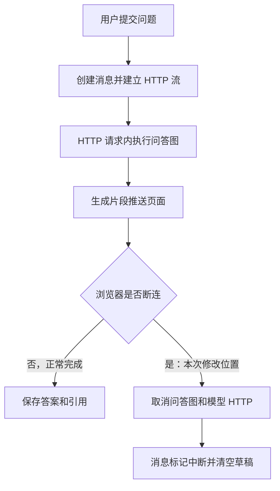
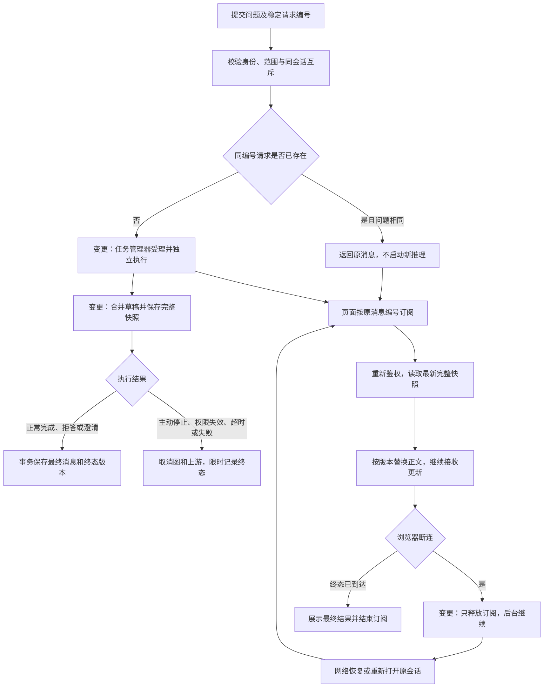

# 问答断连恢复技术方案

日期：2026-10-23。状态：待人工确认；本文全部新增行为均为拟议设计，尚未实现。

对应 [已确认需求](spec-chat-reconnect.md)。本阶段只交付方案和流程图，确认后才修改业务代码。

## 1. 实现思路与取舍

把“执行一次问答”和“向浏览器展示问答”分开。后台任务独立运行，浏览器只订阅结果；浏览器断连仅结束订阅。点击停止、权限失效、超时或服务关闭时，才取消后台问答及上游 HTTP。

首期在现有单 API 进程中增加任务管理器，不把问答塞进入库 Worker，不引入消息队列或分布式任务系统。现有数据库独占锁和进程内撤权屏障继续有效。API 重启不续跑任务；启动恢复将未完成记录标记中断。

恢复展示采用“完整快照”：保存截至目前的完整草稿与版本号，重连先取得最新全文，再持续取得更新。前端替换全文，不追加已经接收过的文本。这样无需保存所有逐字事件，也不需要复原整段事件历史。

代价是周期性写入和发送全文；首期以每 500 毫秒至多一次快照合并更新，阶段变化和终态立即更新，草稿设置 256 KiB UTF-8 上限。持久化失败即结束任务，不边生成边无限丢弃恢复信息。通过慢速替身和接近上限的回答验证负载，必要时在实现阶段调整批量间隔；不把该间隔宣称为已验证性能。

## 2. 已核对的现状与变化点

| 当前实现 | 拟议变化 |
| --- | --- |
| `adapters/http/chat_stream.py` 在请求中启动图；断连取消 producer | 执行归任务管理器；HTTP 层仅负责受理、读取、订阅和停止 |
| `application/chat.py` 准备问题、历史、范围与预算 | 保留这些职责，拆出可幂等受理与独立执行；重连不重建运行上下文 |
| `adapters/postgres/chat.py` 只保存最终答案，重复请求返回 409 | 增加进度快照；相同请求返回已有消息，不再次执行 |
| `graph/baseline.py` 输出内部事件 | 保留内部图事件，由执行侧合并成允许公开的快照，不向订阅方暴露内部字段 |
| `application/barrier.py` 注册 HTTP 请求任务 | 改为注册真实后台任务，订阅发送仍逐次经过读屏障 |
| 前端把 abort 同时用于离开页面和停止 | 页面卸载只结束订阅；停止按钮调用独立停止接口 |
| SSE 解析要求每个 delta 连续编号并追加 | 新协议传完整快照，按版本替换；允许跳过中间版本 |
| API 启动时将 generating 记录改为 interrupted | 保留该行为，同时结束进度快照；不重新调用模型 |

这些现状分别来自上述文件及 `adapters/postgres/conversations.py` 的同会话锁、唯一请求约束，`adapters/http/app.py` 的生命周期和单进程锁，`frontend/src/features/chat/ChatView.vue` 的卸载取消逻辑。

## 3. 流程图：标注变化位置

### 3.1 现有流程



### 3.2 目标执行与订阅流程



图中“只释放订阅”不连接到取消分支。后台即使没有任何订阅者，也继续执行、保存快照并受原 deadline 约束。目标状态均为计划行为，不代表当前代码已经具备。

## 4. 新增实体与复用实体

| 实体 | 定义 | 具体例子 | 用途 |
| --- | --- | --- | --- |
| 后台任务管理器 `ChatRunManager`（新增，进程内） | 由 API 生命周期持有、统一管理问答异步任务的对象 | `message_id=m-101` 对应一个运行中的图任务，页面连接数为零也继续执行 | 保持任务强引用，限制并发，处理停止、撤权和服务关闭；不承诺进程重启恢复 |
| 进度快照 `chat_progress`（新增，数据库，一消息一行） | 已生成草稿、当前阶段、递增版本号及更新时间 | `message_id=m-101, revision=12, stage=generating, draft_answer=截至目前全文` | 页面恢复、轮询和订阅读取最新状态 |
| 展示快照 `ChatSnapshot`（新增，接口数据结构） | 由消息和进度记录一致读取后构造的允许公开内容 | `revision=13, status=completed, answer=完整回答, citations=[...]` | 统一首次读取、重连和最终展示；不是额外数据库表 |
| 页面订阅（新增，临时连接） | 一条只读取某条消息快照的 HTTP 流 | 页面从 `revision=12` 更新到 `revision=15` | 只控制展示；不拥有任务、不计入模型调用次数 |
| 待确认提交记录（新增，浏览器本地） | 提交回执到达前保存的最小重试信息 | 当前用户、会话、请求编号和原问题 | 应对提交响应丢失；受理确认后删除，不保存令牌、答案或引用 |
| 消息 `messages`（复用） | 一次用户提问及其正式结果 | `request_id=q-001`、`status=generating` | 继续作为去重、同会话互斥与终态的权威记录，不新增第二套问答状态 |
| 模型运行与尝试记录（复用） | 既有调用、预算、用量与错误审计记录 | 一次问答的 embedding、rerank、生成调用 | 保留调用计量；重连不新增模型运行 |

内部管理器注册的是消息编号对应的任务；现有 `model_runs.id` 仍仅用于审计，不作为未经授权的公开读取入口。

## 5. 数据与状态约束

新增显式迁移，为 `chat_progress` 建立 `message_id` 主键与外键，保存 `revision bigint`、`stage`、`draft_answer`、`stop_reason`、`updated_at`。消息删除时级联删除进度。准备受理时创建初始版本；更新草稿时锁定关联消息，只有 `generating` 才允许写入，并递增版本。正式答案和引用仍放在 `messages`。

每次快照读取使用一个一致的数据库读取视图联接消息和进度。正常完成时，消息状态、正式答案、引用、进度终态版本和草稿清除在同一事务提交。错误或停止时也用条件更新写入唯一终态。所有后续写入必须检查消息仍在生成，已完成结果不能被迟到的异常覆盖。

后台内存仍合并图的原始文字片段，数据库只保存批量后的最新草稿。最终成功必须先通过现有引用校验；正在生成时引用列表为空，正文明确标注草稿。停止、错误、超时和重启时清空草稿；草稿不进入后续模型历史，不伪装成正式答案。

消息业务状态沿用 `generating / completed / clarify / refused / interrupted / error`；页面的“连接断开、重连中”独立于这些状态。权限受限对外投影为 `restricted`，不泄露草稿、正文和引用。

## 6. 接口契约与受理可靠性

| 接口（拟议） | 行为 |
| --- | --- |
| `POST /api/v1/chat` | 请求仍为 `session_id / request_id / question`；首次受理返回 202 JSON，包含 `message_id / request_id / status`；同编号同问题返回 200 原消息；同编号不同问题返回 409 |
| `GET /api/v1/sessions/{session_id}/messages/{message_id}` | 校验所有权和资料权限，返回最新 `ChatSnapshot` |
| `GET /api/v1/sessions/{session_id}/messages/{message_id}/events` | GET 流式订阅，只发送完整快照和保活，不触发任何模型调用；首个事件始终是当前快照 |
| `POST /api/v1/sessions/{session_id}/messages/{message_id}/stop` | 显式停止；在同一任务的终态仲裁下取消图，返回最终状态；已结束则返回已有状态，不覆盖已完成结果 |

新接口替换旧 POST SSE 契约，前后端、OpenAPI、协议文件和测试在同一版本切换，不保留第二条旧执行链。当前仓库发现自有前端和测试调用；实施时须再查外部调用记录，如存在有效消费者，需补充兼容范围后再切换，不能悄悄破坏外部使用。

受理也由生命周期托管的短任务完成。HTTP 请求等待受理结果时，断连不能取消已经提交的受理操作。管理器为同一用户、会话和请求编号协调受理，数据库会话锁和唯一约束是最终防重依据；只有新建者可以启动执行。受理完成前，消息、来源依赖、进度初值、模型运行记录与任务注册必须完整，失败后将已创建消息收束为错误，不留下无人管理的 generating 记录。

202 只在后台任务已经由管理器接管后发送。若回执丢失，前端以原编号和原问题重试，返回同一消息。若整个 API 此时崩溃，启动恢复负责标记中断，不自动重做推理。同会话只允许一个生成任务，继续使用现有数据库约束；进程内管理器增加可配置的全局及每用户活动任务限制，方案默认分别为 8 和 2，超限返回 429，不在内存中无限排队。

浏览器在首次提交前按用户划分保存待确认记录，收到受理回执或从历史中确认原请求后删除；退出登录清理该用户记录。重开页面先核对服务端历史，必要时用原编号重试；重复受理结果不能被前端当成新消息。

## 7. 快照协议、恢复与页面行为

新流固定发送 `event: snapshot`，数据例子：

```json
{
  "schema": "chat-snapshot-v1",
  "request_id": "q-001",
  "message_id": "m-101",
  "revision": 12,
  "status": "generating",
  "stage": "generating",
  "answer_kind": "draft",
  "answer": "截至目前已生成的全部正文",
  "citations": [],
  "stop_reason": null
}
```

终态快照使用相同结构；成功时 `answer_kind=final`，错误或中断时为 `none`。拒答和澄清同样是已结束的业务结果，其说明文字为正式输出。`revision` 是该消息持久化快照的版本，不是订阅连接内的事件计数。

前端允许首个版本号从任意正整数开始；后续仅接受同一消息的更高版本，用 `answer` 替换当前全文，旧版本丢弃。版本可以跳跃，因为每次都是完整内容；不使用旧解析器的逐条连续 delta 约束。收到终态快照正常结束；没有终态的 EOF、读取超时或临时网络错误只触发重新订阅，不标记业务失败、不重新 POST 新请求。

订阅方每次连接先读最新快照，再等待进程内更新提示；同时每 1 秒检查版本，避免“先读后订阅”的竞态或通知丢失导致漏掉最后一次更新。通知仅提示有变化，正文始终由数据库读取；不为每个慢客户端保留无限事件队列。慢客户端跳到最新快照，不反压模型生成；网络发送保留超时限制及周期保活。

自动重连采用 1、2、4、8、最多 15 秒并加入小幅随机延迟；online、页面回到前台或重新打开原会话时立即尝试一次。鉴权失败停止自动重连并引导登录，无权访问时清空展示并停止重连，业务终态不再重连。页面显示“正在生成”和“连接中断/重连中”两个独立信息。

允许生成过程中切换会话或新建另一会话，切走只释放该页面订阅。回到原会话后，以历史返回的 `message_id` 获取快照并订阅，不重新提交问题。每个打开视图使用自己的取消控制器和视图世代编号，防止旧会话回调更新新会话。停止按钮不再调用订阅的 `AbortController` 作为业务停止，而是显式调用 stop 接口。

## 8. 权限、取消与竞态

执行侧继续检查发起时的令牌、用户状态、范围和授权修订号，任务时限从首次受理开始，不随重连重置；原有上限默认 110 秒，具体取部署配置。发起令牌过期或被注销时沿用现有中断规则，返回后可重新登录查看已保存结果，但不承诺跨登录续跑。

撤权屏障注册后台任务，即使没有订阅者也能取消；最终发布和进度发布都必须在授权读屏障内复核。订阅方使用自己的当前令牌，每次输出前复核消息所有权及来源权限，并在读屏障内有界写出。历史读取也不能绕过已有的资料来源可见性校验。内部模型 trace、证据内容、令牌不进入公开快照。

停止请求先在任务级互斥区间决定是否可以从 generating 转为中断，再请求取消后台任务、退出上游 HTTP，最后限时写终态。正常完成与停止使用相同仲裁：先成功提交的合法终态获胜，另一方只返回它，不把完整答案覆盖为中断。订阅发送失败从此不调用现有无条件 `abort`，也不反向修改消息状态。

API 关闭时先停止受理，取消所有托管任务并限时等待收尾，再关闭数据库连接池、模型 HTTP 客户端和进程池。若清理失败，启动恢复补齐 generating → interrupted 及进度终态；已完成消息不受影响。恢复修改和迁移需覆盖当前迁移版本检查及部署工具。

## 9. 实施范围与分步提交

1. 数据及接口：新增进度迁移、快照结构、幂等受理与条件终态写入，更新迁移 manifest、启动版本检查及契约。
2. 后台执行：新增任务管理器，迁移图执行、预算、审计、权限注册、取消及生命周期清理。
3. 订阅及停止：改造 HTTP 层，支持 JSON 受理、快照查询、GET 订阅和停止；清理旧请求拥有 producer 的分支及失效的消息清空路径。
4. 前端恢复：稳定请求编号、待确认提交、快照替换、自动重连、切换会话及独立停止；删除旧追加 delta 的死代码。
5. 联测与文档：完成下面的验证，更新现行说明中“断连取消任务”的旧描述；每项独立且已验证的项目代码改动单独 commit。

保持职责分开：任务管理器只管生命周期，图只管问答步骤，存储只管快照和状态，HTTP 层只管传输，前端只管展示与交互。复用已有端口和权限能力，不为单进程方案引入通用任务框架。

## 10. 验证方式与交付门禁

所有新增执行测试先使用本机模型替身，不发起付费推理。技术方案确认后再编码；编码完成提交验证证据，等待人工验收。发布和生产迁移另行授权。

| 验证层 | 关键场景与通过条件 |
| --- | --- |
| 数据库集成 | 同编号并发受理只有一条消息、一个执行；同号异问冲突；同会话互斥；重复请求不占新并发额度；迁移兼容旧消息 |
| 执行与资源 | 无订阅者仍完成；全局/用户额度有效；断连不增加模型调用计数；重连不延长 deadline；草稿超限和数据库失败能收束 |
| 流与恢复 | 重连跨版本不重复漏字；先读后订阅竞态可补齐；终态恰逢断连仍能查到；慢订阅不阻塞生成；未收到终态仅重连 |
| 停止与竞态 | 重复停止、停止与完成并发、取消发生在不同模型阶段；上游关闭；只有一个不可覆盖的业务终态 |
| 权限 | 无订阅时撤权仍取消；重连、快照查询、历史、发送边界均拒绝无权正文；令牌失效停止重连；用户间不能读取或停止对方消息 |
| 生命周期 | 关闭顺序正确；强制终止后启动恢复；未完成草稿清除，不自动重新推理；完成数据保持完整 |
| 真实浏览器 | 慢速替身下切换会话、刷新、关闭重开、离线恢复、丢失受理回执、主动停止；检查全文、引用、状态和调用次数 |
| 工程回归 | 相关 pytest、真实 PostgreSQL、Ruff/mypy、前端协议测试/类型/构建、OpenAPI/契约生成检查；模型问答、登录、权限和历史回归 |

现阶段验证只覆盖方案的代码依据、文档链接和流程图；不把设计检查当作实现测试通过。
