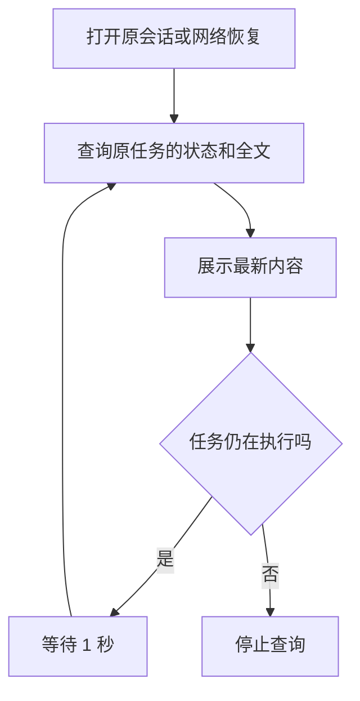

# 问答断连恢复技术方案

日期：2026-10-23。状态：按用户要求简化，待人工确认；尚未实现。

对应 [已确认需求](spec-chat-reconnect.md)。本版替代上一版的快照订阅方案：采用 **API 内异步执行、复用消息表保存进度、前端轮询**。本次只修改文档，方案确认后才编码。

## 1. 实现思路

用户提交问题后，API 保存消息，将本次问答交给进程内的后台异步任务执行，随后返回消息 ID。后台调用原有问答图，定期将已生成的全文写回消息记录；页面每秒查询一次原会话消息，用数据库中的全文替换当前展示。

离开页面、关闭标签页或断网，只会停止页面查询，不取消后台执行。用户回来后重新读取原会话：若仍在生成，继续轮询；若已完成，直接展示答案和引用。只有主动停止、权限失效、超时、执行失败或 API 关闭，才结束后台任务。

这里的“异步消费”由现有单 API 进程中的异步任务承担，可用应用生命周期持有的任务集合实现，不新增独立 Worker、通用任务管理框架或消息队列。保留现有进程内权限撤销机制。API 重启后未完成任务标记中断，不自动重做推理。

本版不新增进度表、快照版本号、事件日志、SSE 恢复协议或订阅通知机制。用户看到的是约每秒更新的正文，而非逐字推送；后台也每秒合并写入一次，因此更新等待通常约 1～2 秒，另受网络和处理耗时影响。

## 2. 现状与改动位置

| 当前实现 | 本次变化 |
| --- | --- |
| `adapters/http/chat_stream.py` 在 HTTP 请求内执行图，断连取消 producer | 将执行移到 API 托管的异步任务，HTTP 请求只负责提交或查询 |
| `application/chat.py` 准备历史、知识库范围、模型预算 | 继续复用；同一请求只准备和执行一次 |
| `adapters/postgres/chat.py` 只保存最终答案；重复请求返回 409 | 生成中也定期更新 `messages.answer`；重复请求返回原消息 |
| `graph/baseline.py` 输出内部进度和文字片段 | 保留图的内部事件，后台合并正文后写数据库，不新增对外流协议 |
| `application/barrier.py` 注册 HTTP 请求任务 | 改为注册后台任务，页面不在时也能因撤权取消 |
| 前端 `ChatView.vue` 通过 SSE 追加文字，卸载时 abort | 改为轮询原消息、替换全文；停止按钮调用独立停止接口 |
| API 启动时将 generating 记录标记 interrupted | 继续使用，并清空未完成正文；不恢复执行 |

上述为已核对的代码现状，目标行为仍待实现。消息去重和同会话互斥继续依靠 `adapters/postgres/conversations.py` 的会话锁、唯一请求约束及生成中唯一索引。

## 3. 目标流程：后台执行和前端查看互不控制

**任务一旦受理，前端是否在线、是否打开页面、是否查询进度，都不决定后台是否继续执行。** 下面分开画两张图，两者只通过同一条消息记录关联。

### 3.1 后台：受理后独立执行

这张图只画正常执行路径，不检查浏览器是否在线。

即使用户关闭浏览器，后台也继续走完这条路径。只有明确停止、权限失效、超时、执行失败或 API 关闭，才转入第 7 节的终止处理；前端断网不在这些条件中。

### 3.2 前端：只读取原任务并展示

离开页面或断网，只暂停这张图中的查看行为；回来后从“查询原任务”继续。**“停止查询”只是前端不再读取，绝不等于取消后台任务。** 用户点击“停止回答”才调用独立停止接口。

| 变化位置 | 原实现 | 目标行为 |
| --- | --- | --- |
| 后台执行的归属 | 跟随浏览器 HTTP 连接 | 跟随已受理任务，独立运行 |
| 页面断网或关闭 | 取消后台问答 | 仅暂停前端查看，后台继续 |
| 页面回来 | 中断任务需要重新提问 | 读取原任务的进度或最终结果 |

提交去重和主动停止的细节分别见第 5、7 节，不再与正常执行、前端轮询交叉画在一张图里。

## 4. 新增概念与复用数据

| 概念或记录 | 定义及具体例子 | 用途 |
| --- | --- | --- |
| 后台异步任务（新增，进程内） | 一条已受理消息对应一次执行，例如 `message_id=m-101` 的问答任务 | 脱离提交请求运行；应用持有任务引用并负责停止、撤权和关闭时清理 |
| 页面轮询（新增，前端行为） | 每隔 1 秒读取原会话消息；同一页面最多一个查询在途 | 恢复已有正文和状态，不再次发起推理 |
| 待确认提交记录（新增，浏览器本地） | 回执到达前保存当前用户、会话、请求编号和原问题，例如 `request_id=q-001` | 回执丢失时用同编号重试；确认受理后删除，退出登录清理，不保存令牌或答案 |
| `messages`（复用） | `id / session_id / request_id / question / answer / status / citations / trace` | 同时保存生成中全文和正式结果，不新增数据库表或字段 |
| 原有模型运行记录（复用） | 一次问答对应的模型调用、用量和错误记录 | 查询进度不增加模型运行，不重置预算 |

不为轮询增加版本号：前端串行查询，每次替换全文；页面切换时取消旧查询，并通过视图世代编号丢弃迟到响应，防止旧内容覆盖新会话。

## 5. 接口与受理

| 接口 | 拟议行为 |
| --- | --- |
| `POST /api/v1/chat`（调整） | 请求仍为 `session_id / request_id / question`；首次受理返回 202 JSON，包含消息 ID、请求编号和状态；同编号同问题返回 200 原消息；同编号不同问题返回 409 |
| `GET /api/v1/sessions/{session_id}/messages`（复用） | 返回现有消息字段；生成中的 `answer` 是当前草稿，完成后是正式正文；前端按消息 ID 定位，不拼接全文 |
| `POST /api/v1/sessions/{session_id}/messages/{message_id}/stop`（新增） | 校验所有权后取消后台执行，返回消息当前状态；已完成则保留完成结果，重复停止可安全处理 |

先复用会话历史查询，页面只轮询当前打开且仍有生成中消息的会话；不新增单条快照查询或 events 接口。历史较长时会增加传输量，首期用长会话验证；确有瓶颈再改为按消息查询，而不是提前建立另一套协议。

202 仅在消息和来源范围已保存、后台任务已接管后返回。受理过程由应用托管，客户端取消等待不能撤销已提交的受理。数据库唯一约束是去重依据，只有新建消息的一方启动问答；重复提交返回已有记录，不生成第二次回答。同会话仍只允许一个进行中的问答。

受理后的初始化或任务启动失败，必须把已创建消息收束为错误，不遗留无人执行的 generating 记录。若 API 突然退出，由现有启动恢复标记中断。提交回执丢失时，页面先按原请求编号检查历史，必要时用原编号和原问题重试，不能生成新编号自动重提。

本版将旧 POST SSE 调整为 JSON 受理，前端、OpenAPI、契约和测试随同发布；不保留第二条旧问答执行链。实施前核对外部接口消费者，若存在有效使用，先补充兼容安排再切换。

## 6. 保存与展示规则

后台在内存中合并原有图事件，每 1 秒至多写一次当前全文到 `messages.answer`，没有变化不写；正常结束、拒答、澄清和错误立即记录最终状态。正在生成时 `citations` 保持为空，前端明确标记“正在生成，内容尚未校验”。

正文设置 256 KiB UTF-8 上限。更新草稿必须带 `status='generating'` 条件；正式答案、引用、状态和摘要在一次事务内保存，引用校验继续使用现有规则。停止、错误、超时或重启时清空未完成正文；下一轮历史仍只取原有允许的已完成或澄清轮次。

数据库写入失败时结束该任务并尽力记录错误，不能无限生成却不保存进度。恢复或错误清理必须是条件更新，不能把已完成结果覆盖为中断。页面查询失败本身不修改消息状态，也不调用停止接口。

当前页成功查询后，若仍在生成，等待 1 秒再查询；到达终态则停止。网络故障时保留已显示的草稿并提示“连接中断”，按 1、2、4、8、最多 15 秒退避重试；online、页面回到前台或重新打开会话时立即查一次。鉴权失败引导登录，权限受限时清空无权内容并停止查询。

允许生成过程中切换会话。切走只清理轮询定时器和当前查询；回来后先读取历史，再根据数据库状态决定是否继续轮询。点击“停止”独立调用 stop 接口，不把取消 HTTP 查询当成取消问答。

## 7. 权限、停止与服务生命周期

后台继续复用既有身份、资料范围和授权修订校验，撤权屏障注册真实后台任务；即使页面不查看，也会取消受影响的执行。每次查询复用历史读取的所有权与来源可见性检查，并保留普通 HTTP 响应的最终权限复核。内部 trace、令牌和无权资料不得因草稿写入而暴露。

停止与正常完成通过同一条消息的条件终态写入仲裁，先成功提交的合法终态获胜；重复停止或迟到异常不能改写已完成结果。停止时取消实际图任务、退出上游 HTTP，再限时记录终态。离线、轮询超时或页面卸载不进入这条取消路径。

任务执行时限从首次受理开始，沿用现有配置和模型预算；重查、回执重试、页面返回都不延长。发起令牌过期或注销时沿用现有中断规则，不承诺跨登录续跑。后台任务不因无人查看而无限执行。

API 关闭时先停止受理，再取消并限时等待后台任务收尾，最后关闭数据库、模型客户端及进程池。API 重启后使用现有恢复规则将未完成消息标记中断、清空草稿，不重新执行。由于不新增表或字段，本方案不要求数据库结构迁移。

## 8. 实施顺序与验证

1. 后端：幂等受理、进程内异步执行、定期保存消息全文及条件终态；迁移预算、审计、撤权注册和应用关闭清理。
2. 接口与前端：JSON 受理、复用消息查询、独立停止、稳定请求编号、串行轮询及页面恢复。
3. 清理：删除旧 SSE 执行与订阅分支、失效的 delta 拼接和断连清空路径，更新契约、现行说明和测试；检索与入库 Worker 不变。
4. 按独立且已验证的代码改动提交 commit，提供验证结果后等待人工验收；发布仍需单独授权。

| 验证 | 通过条件 |
| --- | --- |
| 幂等与受理 | 并发同编号只产生一条消息和一次执行；同号异问冲突；回执丢失能找到原任务；启动失败不遗留生成中消息 |
| 断连与恢复 | 慢速模型替身下刷新、切换会话、关闭重开、离线恢复，后台继续；正文不重复、不缺失；调用次数不增加 |
| 轮询行为 | 同一视图最多一个在途查询；切走清理定时器；旧响应不更新新视图；终态停止轮询；失败仅重查、不重提问题 |
| 数据与竞态 | 草稿更新不会覆盖终态；停止与完成并发只留一个结果；完成时恰好查询失败，返回后仍能读到正式答案和引用 |
| 权限与停止 | 无页面查看时撤权仍取消；历史和草稿无权时遮蔽；其他用户不能读取或停止；主动停止能关闭上游 |
| 时限与生命周期 | 无人查看仍按原预算超时；API 重启标中断且不自动推理；关闭先清任务再关依赖；长会话轮询及长正文写入有界 |
| 工程回归 | 相关 pytest、真实 PostgreSQL、前端协议/类型/构建、本机模型替身与真实浏览器联测，更新 OpenAPI；不调用付费模型 |

本阶段仅验证文档链接、规格对应关系和流程图，不将文档检查视为业务实现通过。方案待人工确认后再编码。
