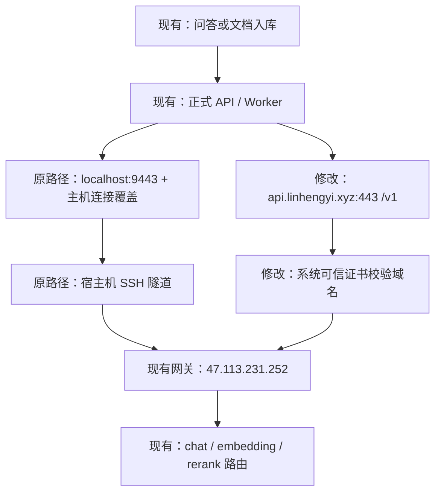

# 模型网关域名切换技术方案

日期：2026-10-21。状态：[需求](spec-gateway-domain-20261021.md) 及本技术方案均已人工确认，切换与自动验证完成；下文核查结论为切换前快照，实际结果见 [切换记录](gateway-domain-deployment-20261021.md)，真实问答待人工验收。

## 核查结论

- 正式 API 和 Worker 均由 `helpdesk-python:179ac07` 运行，三类模型端点来自生产目录 `/opt/it-helpdesk-rag-python-20261018/source/.env.python`。
- 生效 Compose 配置确认：`compose.server.yaml` 和 `compose.public-https.yaml` 没有覆盖本次要改的五项变量。
- 已在正在运行的 API 容器内临时构造新配置，以应用自身的 HTTP 客户端和系统证书库分别使用三类现有 Key 执行 `GET https://api.linhengyi.xyz/v1/models`。三次均返回 200，包含 `chat`、`embedding`、`rerank` 别名；未发送模型推理请求，未保存临时设置到生产环境。
- 当前代码已支持完整模型端点、系统可信证书以及不覆盖连接主机的模式。本次无需修改业务代码或构建应用镜像。

## 改动配置

仅修改正式 `.env.python` 的以下五项；保留文件中的其他变量和文件权限。

```dotenv
HD_CHAT_URL=https://api.linhengyi.xyz/v1/chat/completions
HD_EMBEDDING_URL=https://api.linhengyi.xyz/v1/embeddings
HD_RERANK_URL=https://api.linhengyi.xyz/v1/rerank
HD_MODEL_CONNECT_HOST=
HD_MODEL_CA_FILE=
```

清空 `HD_MODEL_CONNECT_HOST` 后，连接直接使用新域名，不再将连接地址替换为宿主机隧道。清空 `HD_MODEL_CA_FILE` 后，配置解析采用默认的系统可信证书库。代码仍然校验证书与主机名，不接受重定向，不读取环境代理。

以下设置逐项对比保持原值：通用及三类专用 Key、实际模型身份、三个请求别名、向量维度 `1024`、重排序格式 `generic`、推理开关及调用限制。旧证书文件和共享隧道服务保留，供其他环境或回退使用；不把它们从整个服务器移除。

## 调用流程变化



原路径在正式 API/Worker 中被新路径替代。模型、参数、授权和业务数据沿用现有设置，其他环境的旧路径仍保留。

## 实施顺序与影响

1. 在当前隔离分支补充切换维护说明。实施前记录四个正式容器的 ID、镜像 ID，以及五项旧值；在服务器受限目录备份完整 `.env.python`，备份权限为 600，不传回本机或 Git。
2. 再核对当前配置及新网关认证访问；检查正在生成的回答和排队/执行中的入库任务。选择无在途任务时切换，发现任务则先等待，不为改地址强制终止业务任务。
3. 短暂停止正式 Worker 和 API，使切换窗口不再产生新业务写入；该窗口内问答、登录等 API 请求可能短暂不可用。数据库、Web 和 Caddy 持续运行。
4. 精确替换上述五项，检查每项唯一且旧值符合核查预期。对比其余配置完全一致，使用全部生效的 Compose 文件执行配置校验，检查两服务解析后的端点和其他关键项。
5. 沿用既有镜像重建 API、Worker，并等待 API 健康和 Worker 正常运行。所有 Compose 命令均携带 `compose.yaml`、`compose.server.yaml`、`compose.public-https.yaml`，避免将新版备案 Web 恢复成旧镜像。
6. 在 Web 内先执行 `nginx -t`，再重载 nginx，以重新解析 API 的容器地址。Web 镜像和容器不重建；数据库、Caddy 及共享模型隧道服务不改。
7. 按下述表格验证并记录结果，更新部署说明、维护命令和 commit。真实问答由用户在正式站点人工验收。

由于配置从进程启动环境加载，仅修改文件或执行容器 restart 不能可靠更新环境变量，因此需要重建 API、Worker。切换时保持单 API 进程，不绕过现有数据库进程锁。

## 新增实体

无新增业务实体、数据库表、API 接口或系统服务，仅增加部署记录与回退材料。

| 材料 | 定义与例子 | 用途 |
| --- | --- | --- |
| 配置备份 | 服务器受限目录中的原始配置副本，例如 `/opt/it-helpdesk-gateway-domain-20261021/backup/.env.python`，权限 600 | 原样恢复五项旧设置及原有环境 |
| 变更验证记录 | 同目录 `artifacts/` 中的脱敏 JSON，记录端点、容器身份、认证状态和检查结论 | 证明本次生效范围并支持回退核对 |

记录不包含 Key、令牌、业务正文或完整环境文件，也不输出完整 Compose 展开内容。

## 验证方式

| 项目 | 通过条件 |
| --- | --- |
| 配置来源及差异 | 仅五项发生预期变化；其余变量逐项一致；凭据使用进程内比较，仅输出一致/不一致 |
| 配置解析 | 完整 Compose 配置校验通过；API、Worker 实际加载的新 Settings 为新完整端点、连接覆盖为空、附加 CA 为 None |
| 应用认证访问 | 重建后分别在 API、Worker 容器内用实际客户端、现有三类 Key 执行元数据 GET；均为 200，预期别名齐全；正常证书验证，不调用 POST 推理 |
| 启动与身份 | API healthy、Worker running；镜像 ID 沿用原版本；Web 和数据库的容器 ID、镜像 ID 不变 |
| 反向代理 | nginx 配置校验与重载成功；公网 `/health` 200，`chat_ready=true`，页面和静态资源正常 |
| 基础业务 | 使用已有授权账号验证登录、历史读取和退出；不新建会话、上传文档或修改现有授权；测试会话退出后失效 |
| 数据与调用范围 | 不执行数据库迁移、向量重建或质量评测；自动验证的付费模型推理调用数为 0 |

本次没有业务代码和模型协议变更，不重复运行整套业务回归或新增镜像构建；使用实际配置解析、认证 GET 与公网基础业务检查验证这次配置变化。元数据 GET 不能证明真实推理输出质量，报告明确将真实问答列为待人工验收。

## 失败回退

配置校验失败时不启动新配置。若两服务已经停止，立即原样恢复备份、用相同镜像及全部 Compose 文件恢复原 API、Worker，重载 Web nginx，复核原路径健康。

重建后任何关键检查失败，同样恢复完整原配置并重建 API、Worker；原隧道和证书保留，可恢复旧地址。回退只恢复配置和进程，不还原数据库快照或覆盖切换期间的数据。

## 确认节点

按用户提供的 `AGENTS.md`，用户确认本技术方案后才修改生产环境和重建服务；完成验证与对应 commit 后，由用户人工验收。
