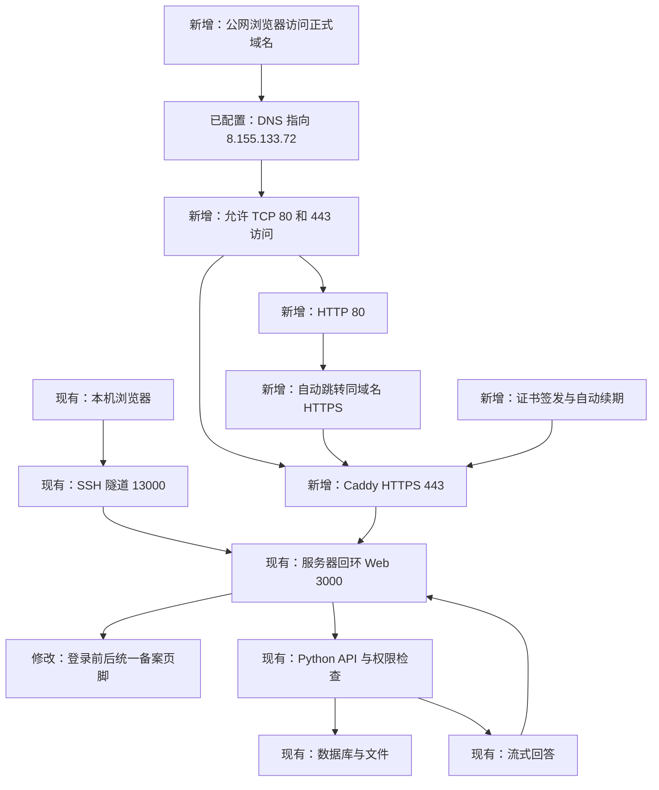

# 公网 HTTPS 与备案展示技术方案

日期：2026-10-21。状态：[需求](spec-public-https-20261021.md) 和本技术方案均已人工确认，进入编码、验证和部署阶段；下文核查结果为实施前的只读快照，实际执行结果另记。

## 当前核查结果

- 本机 DNS 查询返回 `helpdesk-rag.linhengyi.xyz → 8.155.133.72`；AAAA 查询未返回 IPv6 地址。实施时再通过公共解析器复核。
- 已通过既有 SSH 密钥和已保存的服务器主机密钥只读核对目标服务器。
- 正式 Web、API、数据库容器 healthy，Worker 运行中；`http://127.0.0.1:3000/health` 返回 200。
- 宿主机为 Alibaba Cloud Linux 3；未安装 Caddy，宿主机无 Caddy/nginx 服务，TCP 80/443 无监听。firewalld 当前 inactive，本方案不改变该状态。
- 本机访问域名 HTTP 超时；无监听已是接入缺口，但不能据此判定阿里云安全组是否放行。安全组当前规则尚未核查。
- 前端 `App.vue` 的已登录工作区已有页脚，登录页尚无备案展示。现有 nginx 对 `/api/` 关闭代理缓冲，读取超时为 125 秒。

## 访问流程与变化位置

公网域名为 `helpdesk-rag.linhengyi.xyz`。Caddy 负责接收浏览器 HTTPS 请求，再将请求交给现有 Web；Web 继续提供前端并转发 API。数据库、API、候选环境和模型网关保持现有内部访问方式。

## 实现内容

### HTTPS 入口

1. 从 Caddy 官方发布渠道取得固定版本的 Linux amd64 程序，校验发布校验和，记录版本与文件哈希。采用官方 Linux 系统服务方式运行，使用专用 `caddy` 系统用户与持久化数据目录，不使用 root 身份运行常驻代理。
2. 复用仓库 `deploy/Caddyfile` 的 `APP_DOMAIN` 模板，通过系统服务的环境文件设置域名。转发目标固定为 `127.0.0.1:3000`；配置先通过 `caddy validate`，再启用服务与开机自启。
3. 由 Caddy 自动申请、更新可信证书并执行 HTTP 到 HTTPS 跳转。证书状态目录保留在服务器，私钥不进入仓库和报告。自动签发及续期依赖 DNS、80/443 可达和服务器出网，依据 [Caddy 自动 HTTPS 文档](https://caddyserver.com/docs/automatic-https)。
4. 核对云端安全组：仅补充需要的 TCP 80/443 入站规则，SSH 管理范围保持原状。若当前工具无法操作云控制台，提供具体规则给用户配置，并把外部可达标为待验证；不关闭防火墙或扩大其他端口范围。
5. 复用 nginx 的流式转发设置。Caddy 对 `text/event-stream`（服务器逐段发送事件的响应）支持立即转发，保持默认取消传播行为；不添加 `flush_interval -1`，避免它使客户端断开后请求仍在上游继续。依据 [Caddy 流式响应说明](https://caddyserver.com/docs/caddyfile/directives/reverse_proxy#streaming)。
6. 不新增访问日志中的业务正文或令牌记录。运行日志仅用于证书、启动及故障排查，交付记录脱敏。

### 备案展示

1. 新增简单的共享 `SiteFooter.vue`，展示原产品说明与 `粤ICP备2026161349号`，链接为 `https://beian.miit.gov.cn/`。
2. 在 `App.vue` 的登录与工作区分支之外统一渲染页脚，移除工作区原有重复页脚；登录页主体高度及样式随之调整，使桌面和手机布局均可正常阅读。
3. 备案号与查询链接作为该站点的固定展示信息，不新增数据库表、接口、后台配置中心或通用模板系统。
4. 仅构建和更新正式 Web 镜像；原 API、Worker、数据库及卷沿用当前发布版本。记录 Web 的独立提交版本，避免把前后端标记成同一新版本。公网域名下需重新登录，原域名或本机地址的浏览器登录状态不会自动转移。

## 新增实体及用途

| 实体 | 定义与具体例子 | 用途 |
| --- | --- | --- |
| Caddy 系统服务 | 宿主机新增常驻进程，例如 `caddy.service` | 提供公网 HTTPS，开机自动恢复 |
| 域名环境文件 | 系统服务读取的站点设置，例如 `/etc/caddy/helpdesk.env` 中的 `APP_DOMAIN=helpdesk-rag.linhengyi.xyz` | 复用配置模板并明确目标站点 |
| 证书状态目录 | `caddy` 用户可持久写入的目录，例如 `/var/lib/caddy` | 保存证书、私钥和续期状态 |
| 备案页脚组件 | 前端共享组件，例如 `rewrite/frontend/src/shared/SiteFooter.vue` | 在登录前后统一展示备案信息 |

这些是部署和展示实体，不增加业务数据实体。

## 实施顺序与发布范围

1. 再核对 DNS、端口、当前 Web 镜像和现有配置，保存可恢复的配置及镜像版本记录。业务数据无需迁移或结构修改。
2. 在当前隔离分支实现页脚和部署说明，完成下述检查后提交代码；不自动推送或合并 PR。
3. 向 `8.155.133.72` 传输本轮已提交的前端与部署文件，校验哈希。配置与证书在服务器本地生成，不重新传输模型密钥、用户数据库或历史内容。
4. 在服务器构建并校验新 Web 镜像，按当前正式 Compose 项目 `it-helpdesk-python` 仅替换 Web 服务。允许 Web 更新时出现短暂连接中断；API、Worker、数据库不重建。
5. 安装并校验 Caddy 配置，检查安全组，启动 HTTPS 入口；完成外部请求与浏览器核验。
6. 保存实际域名、证书有效期、代码与镜像版本、服务状态、通过与待验证项，提交部署记录后交用户验收。

## 验证方式

| 验证 | 方法与通过条件 |
| --- | --- |
| 前端基础 | 运行现有 `npm test`、TypeScript 类型检查和 Vite 构建；仅为本次涉及的页面补充浏览器断言 |
| 备案与布局 | 浏览器检查登录前后备案号及链接；覆盖桌面与手机宽度，无横向溢出或遮挡 |
| 隔离业务回归 | 使用已有合成账号、数据库和模拟模型检查登录、退出、历史、权限、引用下载与流式逐段展示；不让合成验证写入生产数据库 |
| DNS/证书 | 公共 DNS 核对 A/AAAA；域名正常解析访问，证书域名、有效期及证书链验证通过，不跳过证书验证 |
| HTTP 跳转 | 检查 80 端口返回跳转，目标为同域名 HTTPS，页面及静态资源正常加载 |
| 生产业务访问 | 使用既有授权账号验证公网登录、历史读取和已有引用下载；未登录访问受保护接口应被拒绝，退出后会话失效。凭据缺失时由用户人工验收，不重置密码 |
| 代理流式响应 | 隔离环境使用正式代理配置与模拟事件流检查多段到达及客户端取消；与现有前端 SSE 测试共同验证，不能据此宣称真实公网模型问答已经验收 |
| 服务与续期 | 检查 Caddy active/enabled、证书存储持久化与可写；重启 Caddy 后再次验证公网访问。主机整机重启和跨到期时间的真实续期不在本次自动操作中，报告明确区别 |
| 端口边界 | 核对监听地址及实际新增网络规则，数据库、API、候选 Web 和代理管理端口不暴露到公网 |

本轮自动验证的付费模型请求数为 **0**。正式域名上的真实问答逐段显示留给用户人工验收；如后续委托代理执行真实问答，再明确调用范围。自动验证不会上传生产文档或重跑评测。

## 失败处理与回退

- 新 Web 验证失败：恢复已记录的旧 Web 镜像，只重建 Web，复核原 `3000` 入口；不回滚数据库或覆盖新业务数据。
- Caddy 配置失败：未通过配置校验不启用；运行后失败则停止新增代理并恢复本轮修改前的配置，保留证书和错误记录供排查。
- 安全组调整失败：仅撤回本轮新增且明确记录的规则，不改动既有规则；原 SSH 隧道继续用于管理与验收。
- 证书签发失败：核对 DNS、网络与签发日志；不关闭浏览器证书校验，不用自签证书冒充公网验收通过。

## 确认节点

按用户提供的 `AGENTS.md`，用户确认本方案后，才进行代码编写、服务器安装、Web 发布和公网入口配置。验证与 commit 完成后，再由用户人工验收交付。

系统服务安装与启动细节依据 [Caddy 官方运行说明](https://caddyserver.com/docs/running)；本方案尚未执行其中的变更命令。
