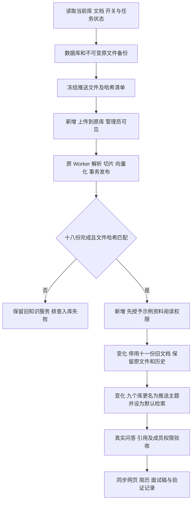
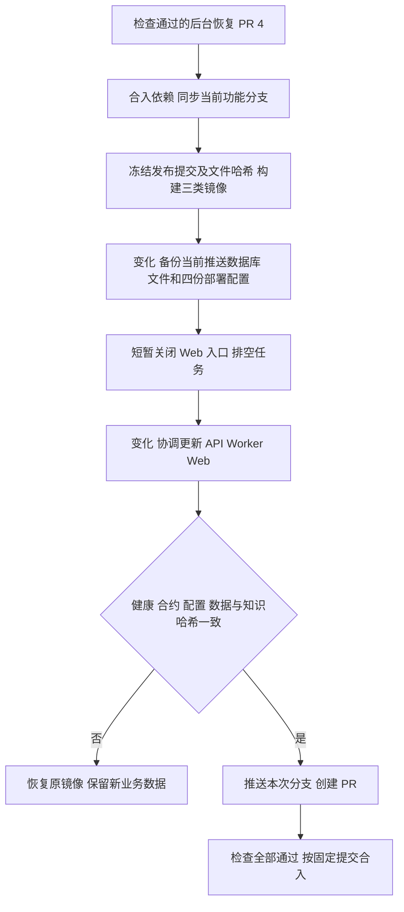

# 推送知识库替换方案

## 实现

正式应用已有知识库创建、文件上传、文档启停和阅读授权接口。使用既有接口导入新资料及切换文档，调用原 Worker 真实向量化。知识库名称和组织字段尚无修改接口，维护脚本在已有 SSH 管理通道内执行限定标识、参数化的元数据更新，不修改结构或模型配置。

九个原库与九个推送主题一一映射，复用库标识。新文件先保持默认的管理员可见范围，全部入库完成并核验后，授予应用内已登录成员阅读这些非敏感示例资料的权限。原十一份文档通过现有撤权屏障停用，原授权关系不扩大。最后改知识库名称、组织和默认检索开关。

## 新增数据实体

| 名称 | 定义和例子 | 用途 |
| --- | --- | --- |
| 推送资料清单 | `knowledge/push/manifest.json`；例如 `PUSH-001` 指向接入清单 Markdown 及 SHA256 | 确定导入哪些文件、归属主题及资料来源，不承载生产标识和凭据 |
| 切换计划 | Git 忽略目录内的 JSON；记录原库名称、组织、默认开关、旧文档启停状态和新文档/任务标识 | 使重试可识别既有上传，支持恢复旧开关及名称，避免重复导入 |
| 冻结验收案例 | `knowledge/push/acceptance.json`；例如“接口成功是否代表已送达”期待生命周期证据 | 记录业务预期、引用与拒答行为；是功能验收样本，不是独立盲测质量集 |

## 顺序和失败处理

- 切换前确认没有生成中的问答或执行中的入库任务。备份位于服务器受限目录；账号和历史正文不进入 Git。
- 不调整模型身份、维度、预算和服务架构。上传失败不切换旧开关；禁止把未入库文件计入已上线资料。
- 先为新公开示例授予登录成员阅读范围，再停用旧文档；两者通过正式授权接口，保留审计和历史遮蔽行为。
- 元数据切换前复核旧库名称与计划一致。脚本仅能更新计划列出的九个库。
- 回退时恢复原库名称、组织、默认开关和旧文档原启停值，停用本次新文档；不恢复整库覆盖切换后的业务写入。
- 网页只改产品文案与提问示例；运行前端现有测试、类型检查和构建。正式 Web 独立更新，保留四个 Compose 配置及 API/Worker/数据库容器。

## 验证和材料

核对资料哈希、任务完成状态、活动版本、切片数量及授权；十二个真实模型案例冻结后一次执行，检查终态、引用与预期证据，失败原样保留。使用成员账号验证可见范围和引用下载。历史 IT 二百题报告原样保留为历史材料，从简历主结果中移除，不能改成推送质量成绩。

## 后续服务端发布与合入

用户已追加授权服务端部署及 PR 合入。以干净提交制作带文件哈希的发布包，在服务器受限新目录构建 API/Worker、前端构建层和 Web 镜像。复用已验证镜像中的锁定依赖，完整替换应用源码，嵌入当前推送示例资料；不自动重新导入、不迁移结构、不修改模型和预算。

新增发布包清单记录提交和打包文件 SHA256，例如 `rewrite/backend/src/helpdesk/application/chat.py` 的摘要，用于确认运行代码来源。部署证据放在 Git 忽略目录及服务器受限目录，追踪旧镜像、切换窗口、表和文件摘要以及回退结果；提交正文仅记录脱敏摘要。保留先前十二题首次结果，本次发布验证不重复调用真实模型择优。
